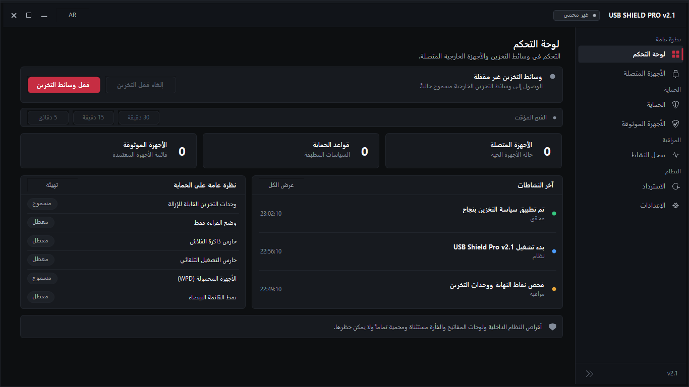
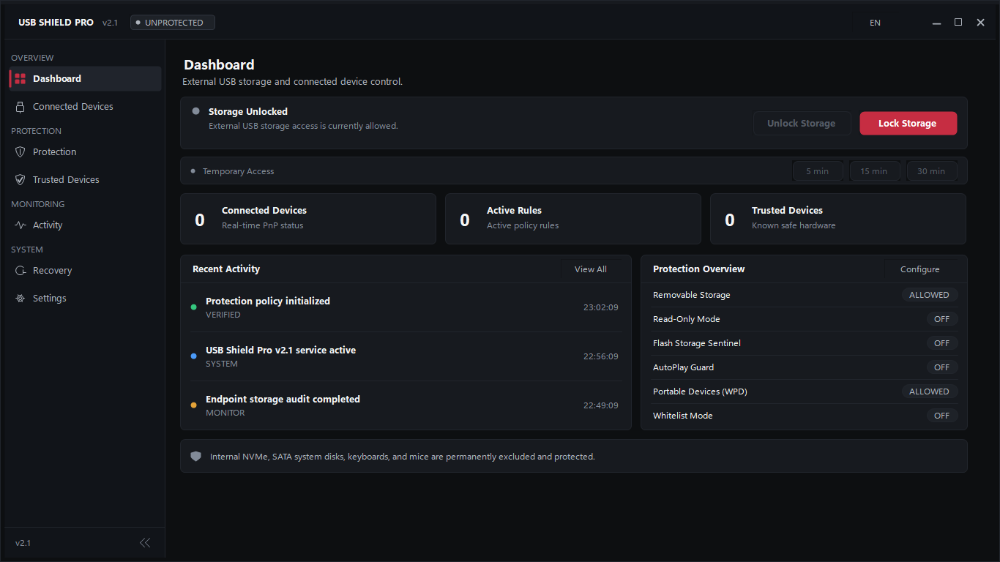
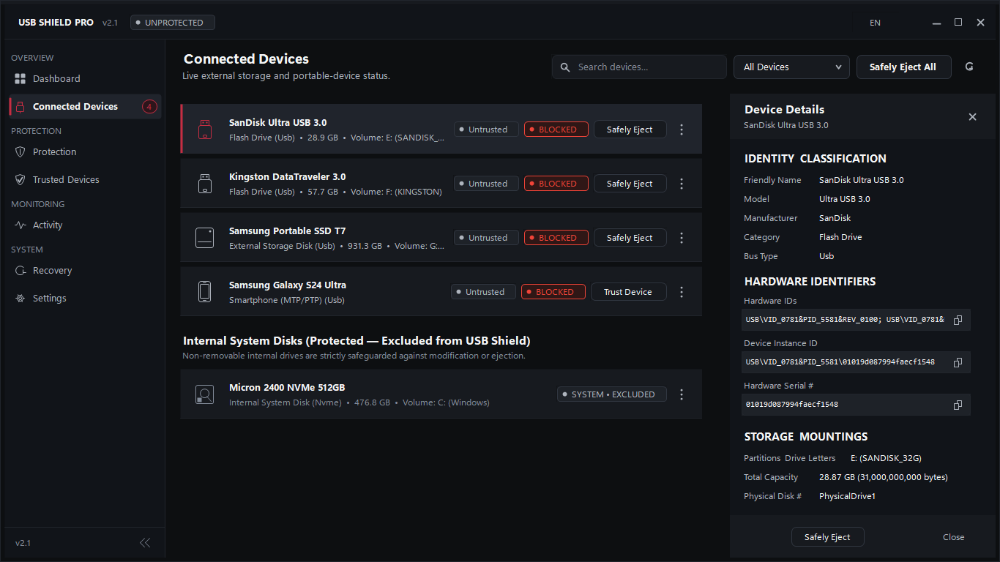
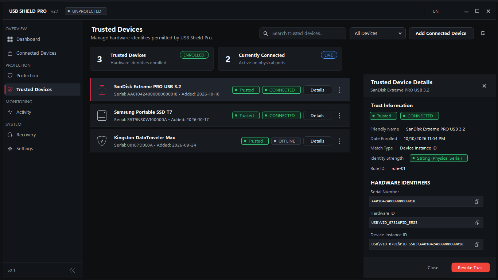
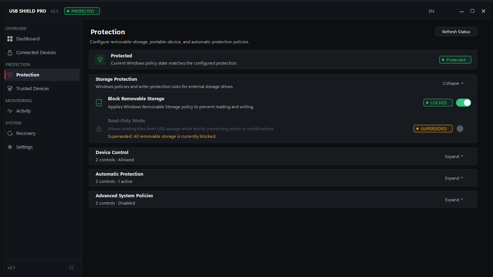
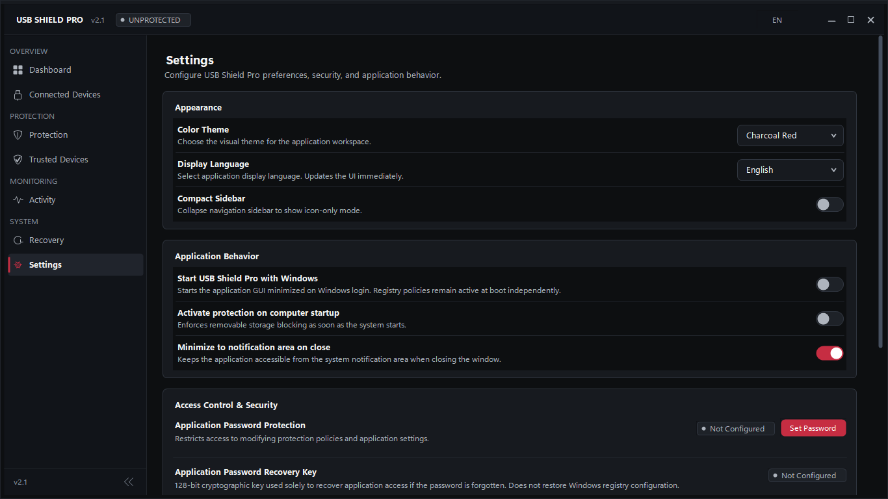

<p align="center">
  
</p>

<h1 align="center">USB Shield Pro</h1>

<p align="center">
  <strong>أداة برمجية جاهزة للإنتاج للتحكم في وسائط تخزين USB ومنافذ التخزين الخارجية على نظام ويندوز لمحطات العمل والمختبرات والبيئات الإدارية</strong>
</p>

<p align="center">
  <a href="README.md"><strong>English</strong></a> &bull;
  <a href="README.ar.md"><strong>العربية</strong></a>
</p>

<p align="center">
  <a href="https://github.com/0x-Abood/USB-Shield-Pro/releases/tag/v2.1.1"></a>
  <a href="https://github.com/0x-Abood/USB-Shield-Pro/actions/workflows/ci.yml"></a>
  
  
  
  <a href="LICENSE"></a>
</p>

---

## نبذة عن المشروع

**USB Shield Pro** هي أداة برمجية مفتوحة المصدر وجاهزة للبيئات التشغيلية والإنتاجية، مخصصة للتحكم في وسائط تخزين USB وأجهزة WPD/MTP على محطات العمل والمختبرات والبيئات الإدارية العاملة بنظام **ويندوز (Windows 10 و Windows 11)**. تهدف الأداة إلى توفير تحكم صارم في وسائط التخزين لحماية الأنظمة من محركات التخزين الخارجية غير المصرح بها، ومنع تسريب البيانات، وتعطيل برمجيات التشغيل التلقائي (AutoRun/AutoPlay).

تعمل الأداة عبر نموذجي تشغيل متمايزين ومتكاملين (Dual Enforcement Models):

1. **النموذج الأول: الإغلاق الشامل عبر المشغل وسياسات النظام (Mode A: System-Wide Policy & Driver Lockdown):** إغلاق شامل يجمع بين تعطيل المشغل على مستوى النواة (`USBSTOR\Start = 4`) وتطبيق سياسات مجموعة ويندوز (`RemovableStorageDevices\Deny_All`). يمنع هذا الوضع وسائط تخزين USB القياسية وأقراص UASP القابلة للإزالة على مستوى النظام كلياً دون استثناءات للقائمة البيضاء (بينما تتطلب حاويات UASP التي تعرّف نفسها كأقراص ثابتة عزل الخدمة التفاعلي في النموذج الثاني).
2. **النموذج الثاني: وضع القائمة البيضاء التفاعلي (Mode B: Reactive Allowlist Enforcement - Detect-and-Eject):** فحص وتحقق لحظي من الهوية العتادية (`VID`/`PID`/الرقم التسلسلي) عبر خدمة النظام الخلفية المستقلة `UsbShieldService` (عندما يكون المشغل في الوضع التفاعلي `Start = 3`). يُسمح للأقراص المعتمدة بالبقاء متصلة والعمل بكامل الصلاحيات، بينما يتم عزل وطرد أي وسيط غير معتمد (بما في ذلك حاويات UASP ذات الأقراص الثابتة) فور توصيله عبر بروتوكول الإخراج الآمن المتزامن للأقسام.

---

## نموذج التهديد والنطاق المعماري (Threat Model & Architecture Scope)

### نطاق التهديدات التي تعالجها الأداة
- **وسائط تخزين USB غير المصرح بها:** فرض الحظر الافتراضي والعزل الفوري للفلاشات والأقراص الصلبة وأقراص SSD الخارجية غير المصرح بها. في النموذج الأول (Mode A)، تُحظر أجهزة `USBSTOR` وأقراص `UASP` القابلة للإزالة مسبقاً، بينما يتم في النموذج الثاني (Mode B) عزل وطرد أي جهاز غير مدرج في القائمة البيضاء (بما في ذلك حاويات UASP ذات الأقراص الثابتة) فور توصيله.
- **تسريب وسرقة البيانات:** حظر نسخ ونقل البيانات عبر سياسات النظام (`StorageDevicePolicies\WriteProtect = 1` و `RemovableStorageDevices\Deny_Write`) لمنع تسريب البيانات والملفات مع إمكانية إتاحة القراءة فقط للفحص.
- **أجهزة الهواتف والوسائط المحمولة (WPD / MTP):** إغلاق قنوات نقل الملفات وتجاوز الحظر عبر بروتوكولات MTP و PTP المستخدمة في الهواتف الذكية والكاميرات عبر سياسات `WPD Devices\Deny_Read` و `Deny_Write`.
- **برمجيات التشغيل التلقائي:** تعطيل التشغيل التلقائي (AutoRun/AutoPlay) على كافة وسائط التخزين لحماية النظام من البرمجيات ذاتية التشغيل بمجرد توصيل الفلاشة (`NoDriveTypeAutoRun = 0xFF`).

### آلية عمل الأنماط وتفاعلها التقني
- **التعطيل الجذري للمشغل (`USBSTOR\Start = 4`):** يوقف تحميل مشغل التخزين القياسي `usbstor.sys` في ويندوز على مستوى النظام بالكامل. عند تفعيل هذا النمط، يتم فرض **وضع إغلاق شامل (System-Wide Lockdown)** يمنع كافة أجهزة التخزين الخارجية من العمل والتعريف، بما في ذلك الأجهزة المدرجة في القائمة البيضاء.
- **التعامل مع أقراص `UASP` مقابل `USBSTOR`:** تعتمد وسائط التخزين الحديثة فائقة السرعة USB 3.x ومحركات NVMe الخارجية على مشغل بروتوكول SCSI المرفق بـ USB (`uaspstor.sys`) بدلاً من `usbstor.sys`. وفي حين يستهدف خيار `Driver Start=4` مشغل `USBSTOR` القياسي مباشرة، يتم تقييد أقراص UASP القابلة للإزالة عبر سياسة `RemovableStorageDevices\Deny_All`. أما حاويات UASP التي تُعرّف نفسها كأقراص ثابتة (Fixed Disks) فتتجاوز سياسات الوسائط القابلة للإزالة، ويتم رصدها وعزلها حصرياً عبر محرك الطرد التفاعلي في الخدمة (`UsbShieldService`) في النموذج الثاني (Mode B).
- **وضع الإغلاق الشامل مقابل وضع القائمة البيضاء:** تعمل سياسات الحظر الكلي على مستوى النظام (`USBSTOR Start=4` أو `RemovableStorageDevices\Deny_All`) كوضع إغلاق شامل للنظام بدون أي استثناءات للأجهزة. في المقابل، يعمل **وضع القائمة البيضاء (Allowlist Enforcement Mode)** عندما تكون المشغلات في الوضع التفاعلي (`Start = 3`): حيث تراقب الخدمة الخلفية المستقلة منافذ التوصيل لحظياً، وتتحقق من الهوية العتادية (`VID/PID/Serial`)، فتسمح للأجهزة الموثوقة بالبقاء متصلة، بينما تطرد الأجهزة غير الموثوقة فور توصيلها.
- **نافذة التعداد اللحظي والإخراج التفاعلي (Reactive Ejection & Enumeration Window):** في وضع القائمة البيضاء التفاعلي، يمر الجهاز غير الموثوق بنافذة تعداد قصيرة على مستوى نظام ويندوز (Windows PnP) قبل أن تلتقطه خدمة `UsbShieldService` وتبدأ تسلسل العزل. يتم تقليص مخاطر هذه النافذة هندسياً عبر:
  1. التعطيل الشامل للتشغيل التلقائي (`NoDriveTypeAutoRun = 0xFF`) لمنع تنفيذ أي كود برمجي تلقائياً عند التوصيل.
  2. تسلسل القفل الحصري والفصل القسري البديل: يحاول المحرك أولاً قفل القسم حصرياً عبر `FSCTL_LOCK_VOLUME` (مع 3 محاولات متتالية). وفي حال فشل القفل بسبب وجود مقابض مفتوحة من عمليات أخرى في النظام (مثل خدمة فهرسة ويندوز أو الفحص الأمني)، ينتقل المحرك تلقائياً وبشكل حتمي كـ Fallback إلى `FSCTL_DISMOUNT_VOLUME` لإبطال وفصل جميع المقابض المفتوحة قسرياً، ويرسل فوراً على نفس المقبض أمرَي `IOCTL_STORAGE_MEDIA_REMOVAL (false)` و `IOCTL_STORAGE_EJECT_MEDIA` قبل إغلاقه واستدعاء `CM_Request_Device_EjectW`. وفي حال فشل القفل الأولي، توجد نافذة سباق زمنية وجيزة (أجزاء من الثانية) قد تحاول فيها بعض البرمجيات أو مشغلات الفرز إعادة فتح القسم قبل اكتمال فصل العقدة العتادية نهائياً عبر PnP.
- **الحماية التشفيرية لمصادقة المسؤول:** يقتصر استخدام التشفير (`PBKDF2-HMAC-SHA256` و `Windows DPAPI`) على حماية مصادقة المسؤول على واجهة البرنامج، وتشفير الإعدادات المخزنة محلياً، وتوليد مفتاح الاسترداد 128 بت لضمان عدم التلاعب بالسياسات.

### القيود الفنية وخارج نطاق الأداة (Limitations & Out-of-Scope)
- **معمارية فضاء المستخدم (User-Mode Service):** تعمل الأداة كخدمة نظام في فضاء المستخدم وتنسق سياسات السجل وإدارة الأجهزة (Registry/PnP Policies)، وليست مشغل نواة منخفض المستوى من فئة (Kernel Minifilter Driver).
- **قراءة ترويسة نظام الملفات عند التركيب (Mount-Time Filesystem Parsing):** في وضع القائمة البيضاء التفاعلي، يقوم نظام ويندوز بتركيب وقراءة ترويسة نظام الملفات (Mount-time filesystem parsing) ومجلدات الفهرسة للحظات وجيزة قبل اكتمال عملية الطرد التفاعلي. يحد هذا الوضع بشكل جوهري من النسخ التفاعلي للملفات والتسريب العفوي للبيانات، مع الإشارة إلى أن أي عمليات مؤتمتة وموجودة مسبقاً على النظام قد تحاول قراءة البيانات بشكل فوري وخاطف خلال نافذة التعداد التي تستغرق أجزاء من الثانية قبل اكتمال الطرد، كما لا يمنع هذا الوضع ثغرات كيرنل قراءة نظام الملفات اللحظية المضمنة في الفلاشة.
- **حاويات الأقراص الثابتة UASP (Fixed-Disk Enclosures):** تُبلّغ بعض حاويات الأقراص الخارجية USB 3.x ومحركات NVMe (UASP) نظام ويندوز بأنها أقراص محلية ثابتة (Fixed Disks) وليست وسائط قابلة للإزالة (Removable Media)، مما قد يتجاوز سياسات `RemovableStorageDevices` في السجل، ويعتمد حظرها حينها كلياً على محرك الرصد والعزل اللحظي في خدمة `UsbShieldService`.
- **الأرقام التسلسلية الفارغة أو المكررة (Blank or Non-Unique Serial Numbers):** تحتوي بعض الفلاشات التجارية الرخيصة أو المقلدة على أرقام تسلسلية فارغة أو مكررة مصنعياً؛ بالنسبة للأجهزة التي تفتقر لرقم تسلسلي، يولد نظام ويندوز معرّف مثيل مرتبطاً بمنفذ الـ USB الفيزيائي (Port-derived Instance ID). يعتمد البرنامج على هذا المعرف المدمج (`VID` + `PID` + مسار المثيل)، وبالتالي فإن نقل تلك الفلاشة إلى منفذ USB فيزيائي آخر سيغير مسار المثيل ويتطلب إعادة اعتمادها وتوثيقها على المنفذ الجديد.
- **مقاومة العبث وصلاحيات مسؤول النظام (Tamper Resistance & Local Administrator Boundary):** تمنع حماية كلمة المرور (`PBKDF2 + DPAPI`) وتقييد أذونات السجل المستخدمين القياسيين (`Standard Users`) والمتسللين على الجلسات المفتوحة من تعديل أو تعطيل الحماية. ومع ذلك، وبطبيعة معمارية أمان ويندوز، فإن أي مستخدم يمتلك صلاحيات مسؤول محلي كاملة (`Local Administrator / SYSTEM`) يمتلك القدرة المعمارية الجذرية على إيقاف الخدمات أو تعديل مفاتيح السجل.
- **التعايش مع بيئات الدومين المؤسسية (Active Directory GPO / Microsoft Intune):** تدير الأداة سياسات السجل المحلية للجهاز (`Local Machine Policies`). في بيئات العمل المؤسسية المدارة بواسطة `Domain GPO` أو `Intune`، قد تقوم سياسات الدومين بالكتابة فوق السياسات المحلية عند تحديث السياسات الدوري (`gpupdate /force`).
- **أجهزة الإدخال وهجمات BadUSB (HID Keyboard Emulation):** العتاد الخبيث الذي يُعرّف نفسه كوحدة إدخال مفاتيح (مثل هجمات BadUSB أو أجهزة Rubber Ducky) لا يقوم بتحميل مشغل التخزين `USBSTOR` ويقع خارج نطاق أدوات التحكم في وسائط التخزين. التصدي لهذه الهجمات يتطلب أقفالاً فيزيائية للمنافذ أو حلول تحكم على مستوى أجهزة HID.
- **تزوير المعرفات العتادية (Hardware Identifier Spoofing):** تعتمد القائمة البيضاء على المعرفات العتادية المصرح بها من قِبل وحدة التحكم في الجهاز. إذا تم استخدام شريحة ميكروكنترولر برمجية قابلة للتهيئة لنسخ نفس الـ `VID/PID` والرقم التسلسلي لجهاز موثوق، فلا يمكن تمييزها على مستوى استعلام فضاء المستخدم دون مصادقة تشفيرية على مستوى العتاد.
- **نطاق جناح اختبارات CI الآلية (CI Test Harness Scope):** يتحقق جناح الاختبارات الآلي في CI على GitHub Actions (32 جناح اختبار / 391 تأكيداً برمجياً) من منطق مطابقة القواعد، وسلامة معاملات السجل ومعاملات التراجع، وبناء الحزم وحماية Disk 0 برمجياً (Unit & Integration Logic)، ولا يقوم بمحاكاة أجهزة USB فيزيائية حقيقية على خوادم GitHub السحابية.

---

## المميزات الرئيسية

- **القائمة البيضاء للمعرفات العتادية (VID/PID/Serial):** السماح فقط للفلاشات والأقراص الموثوقة بالعمل عبر مطابقة رقمها التسلسلي الفريد ومعرفات الشركة المصنعة والمنتج (`VID/PID`).
- **محرك الإخراج الآمن للأقسام المتعددة (Multi-Partition Safe Eject):** حل هندسي متكامل لإخراج الفلاشات المقسمة (مثل فلاشات **Ventoy** والأقراص المتعددة الأقسام) دون أخطاء `PNP_VetoDevice`.
- **التكامل المباشر مع واجهة Win32 SCM (بدون أي عمليات فرعية):** تشغيل نظيف دون إنشاء أو تنفيذ أي ملفات باتش أو سكربتات (`.bat` أو `.cmd` أو `.ps1`). تتم إدارة دورة حياة خدمة الويندوز مباشرة عبر دوال Win32 الأصلية في `advapi32.dll` (مثل `OpenSCManagerW` و `CreateServiceW` و `DeleteService`) دون تشغيل أي عمليات فرعية أو نوافذ أوامر خارجية (`sc.exe` أو `cmd.exe`).
- **خدمة نظام خلفية تعمل على مدار الساعة (Windows Service):** حماية مستمرة حتى قبل تسجيل دخول المستخدم لشاشة القفل عبر خدمة النظام `UsbShieldService`.
- **حماية الأقراص الأساسية (Fail-Closed System Floor):** خط أمان صارم يمنع حظر أو إخراج القرص 0 أو قسم الويندوز أو ملف الذاكرة الافتراضية (`pagefile.sys`).
- **استعادة الإعدادات الأصلية بضغطة زر (Disaster Recovery):** تسجيل إعدادات النظام الأصلية قبل أي تعديل لتمكين استعادتها فورياً بنقرة واحدة أو عبر سطر الأوامر (`--restore-defaults`).
- **واجهة مستخدم عربية بالكامل:** دعم أصلي وكامل للغة العربية (RTL) مع شاشات عالية الدقة (High-DPI 100%–200%) بالوضعين الداكن والفاتح.

---

## واجهة المستخدم (User Interface)

<p align="center">
  
  
</p>
<p align="center">
  
  
</p>
<p align="center">
  
  
</p>

---

## مخطط تدفق الحماية (Architecture Workflow)

```mermaid
flowchart TD
    subgraph ModeA ["المسار الأول: الإغلاق الشامل عبر المشغل والسياسات (Mode A)"]
        A1["توصيل وسيط تخزين USB"] --> A2{"حالة المشغل والسياسة"}
        A2 -- "USBSTOR Start = 4" --> A3["تعطيل تعداد المشغل تماماً على مستوى النواة"]
        A2 -- "RemovableStorage Deny_All" --> A4["سياسة Group Policy تمنع الوصول لكافة الأقراص"]
        A3 --> A5["حظر USBSTOR و UASP القابلة للإزالة دون تقييم القائمة<br>(الحاويات الثابتة تتطلب Mode B)"]
        A4 --> A5
    end

    subgraph ModeB ["المسار الثاني: وضع القائمة البيضاء التفاعلي (Mode B - Start=3)"]
        B1["توصيل وسيط تخزين USB"] --> B2["اكتشاف الحدث عبر PnP (WM_DEVICECHANGE)"]
        B2 --> B3{"حارس أقراص النظام الأساسية"}
        B3 -- "قرص النظام / Disk 0 / ملف الإقلاع" --> B4["خط أمان صارم: قرص نظام أساسي محمي"]
        B3 -- "وسيط تخزين خارجي / فلاشة" --> B5["قراءة الهوية العتادية (VID / PID / الرقم التسلسلي)"]
        B5 --> B6{"مطابقة القائمة البيضاء في RuleEngine"}
        B6 -- "جهاز موثوق (معتمد)" --> B7["السماح بالوصول الكامل للقراءة والكتابة"]
        B6 -- "جهاز غير موثوق (محظور)" --> B8["قفل وفصل الأقسام تتابعياً (FSCTL_LOCK/DISMOUNT)"]
        B8 --> B9["طلب الإخراج العتادي الأصلي CM_Request_Device_EjectW"]
        B9 --> B10["إخراج الفلاشة بأمان حتى فصلها فيزيائياً"]
    end
```



---

## جدول القدرات والآليات الأمنية

| الميزة الأمنية | الآلية التقنية | هل يغطي UASP (`uaspstor.sys`)؟ | هل يسمح بالأقراص الموثوقة؟ | القيمة الأمنية |
| :--- | :--- | :--- | :--- | :--- |
| **التعطيل الجذري للمشغل** | `USBSTOR\Start = 4` | **لا** *(يستهدف usbstor.sys فقط)* | **لا** *(يحظر كافة أجهزة USBSTOR)* | إيقاف تعريف التخزين بالكامل على مستوى مشغل التخزين في النظام. |
| **حظر وسائط التخزين** | `RemovableStorageDevices\Deny_All` | **جزئي** *(يغطي UASP القابلة للإزالة؛ الحاويات الثابتة تتطلب طرد الخدمة)* | **لا** *(يحظر كافة الوسائط القابلة للإزالة)* | منع أي قراءة أو كتابة على وسائط التخزين الخارجية عبر Group Policy. |
| **خدمة القائمة البيضاء التفاعلية** | خدمة ويندوز الأصلية (`UsbShieldService`) | **نعم** *(طرد على مستوى القسم والعقدة العتادية)* | **نعم** *(بناءً على مطابقة VID/PID/Serial)* | مراقبة فورية تعمل بالخلفية لإنفاذ القائمة البيضاء وطرد الأجهزة غير المعتمدة. |
| **وضع الحماية من الكتابة** | `StorageDevicePolicies\WriteProtect = 1` | **جزئي** *(للأقراص القابلة للإزالة فقط؛ الحاويات الثابتة تتجاهل السياسة)* | **لا** *(يفرض القراءة فقط للجميع)* | تصفح محتوى الفلاشة للقراءة فقط ومنع نقل البيانات إليها. |
| **حظر الأجهزة المحمولة (WPD)** | `WPD Devices\Deny_Read / Deny_Write` | **لا ينطبق** *(يغطي MTP/PTP)* | **لا** *(يحظر أجهزة WPD كلياً)* | حظر نقل الملفات عبر الهواتف الذكية والكاميرات المحمولة. |
| **منع تثبيت الأجهزة** | `DeviceInstall\Restrictions\DenyRemovableDevices` | **جزئي** *(أجهزة التخزين القابلة للإزالة)* | **لا** *(يمنع تثبيت التعريفات)* | منع تثبيت تعريفات أجهزة التخزين القابلة للإزالة. |
| **تعطيل التشغيل التلقائي** | `NoDriveTypeAutoRun = 0xFF` | **نعم** *(كافة أنواع الوسائط)* | **لا ينطبق** *(سياسة عامة)* | تحييد ثغرات التشغيل التلقائي بمجرد توصيل الفلاشة. |
| **الإخراج الآمن المتعدد الأقسام** | `FSCTL_LOCK` &larr; `FSCTL_DISMOUNT` &larr; `CM_Request_Device_EjectW` | **نعم** *(يستهدف كافة عقد الأقسام)* | **نعم** *(يُنفذ على الأجهزة غير الموثوقة)* | إخراج الفلاشات المقسمة وحماية البيانات من التلف. |
| **حماية قرص النظام** | حظر إخراج القرص 0 وأقسام الإقلاع | **نعم** *(فحص إلزامي صارم)* | **نعم** *(استثناء إلزامي)* | منع أي مساس بملفات نظام التشغيل أو أقراص الويندوز. |
| **الأمان التشفيري** | PBKDF2 (HMAC-SHA256) + DPAPI | **لا ينطبق** *(حماية الإعدادات)* | **لا ينطبق** *(مصادقة إدارية)* | تأمين مصادقة المسؤول على واجهة البرنامج وتعديل السياسات ومفتاح الاسترداد 128 بت. |

---

## مصفوفة العتاد والسلوك المختبر فعلياً (Verified Hardware Matrix)

السلوك الفعلي المرصود والموثق تجريبياً على بيئات عمل Windows 10 (v1903+) و Windows 11 x64:

| فئة العتاد والتوصيل | سلوك النمط الأول (Mode A - الإغلاق الشامل) | سلوك النمط الثاني (Mode B - القائمة البيضاء) | الدلالة الهندسية وضمانات السلامة |
| :--- | :--- | :--- | :--- |
| **قرص الإقلاع الداخلي NVMe**<br>*(القرص 0 / قسم الويندوز `C:`)* | **مستثنى ومحمي دائماً**<br>يعمل بكامل الصلاحيات ودون أي قيود على الإطلاق. | **مستثنى ومحمي دائماً**<br>تجاوز إلزامي لحماية النواة؛ محصن ضد أي قفل أو فصل أو إخراج. | حماية برمجية صارمة غير قابلة للتعطيل (`SystemDeviceSafetyGuard`) تمنع المساس بملفات النظام. |
| **الأقراص الداخلية الثابتة SATA / AHCI / RAID**<br>*(أقراص التخزين الداخلية غير التابعة للويندوز)* | **مستثناة ومحمية بالكامل**<br>تظل كافة مسارات وأقراص التخزين الداخلية متاحة وتعمل بلا أي قيود. | **مستثناة ومحمية بالكامل**<br>يضمن فحص النواقل الإيجابي عدم استهداف الأقراص الداخلية أو طردها إطلاقاً. | التحقق العتادي الدقيق من عدم انتماء مسار الجهاز لناقل الـ USB (`PositiveUsbEvidenceInvariant`). |
| **فلاشة USB 2.0 / 3.0 قياسية**<br>*(مشغل `USBSTOR`)* | **محظورة كلياً**<br>يتوقف تعريف المشغل (`Start=4`) أو يُمنع الوصول بالكامل عبر `Deny_All`. | **إنفاذ القائمة البيضاء**<br>تبقى الفلاشات المعتمدة متصلة، وتُطرد أي فلاشة غير مصرح بها فورياً. | مطابقة الهوية العتادية عبر `VID`/`PID`/الرقم التسلسلي خلال نافذة وصول PnP. |
| **فلاشة مقسمة ذاتية الإقلاع**<br>*(مثل Ventoy: قسم EFI + قسم البيانات)* | **محظورة كلياً**<br>تُحظر كافة الأقسام التابعة مسبقاً على مستوى المشغل والسياسة. | **إنفاذ القائمة البيضاء**<br>قفل وفصل جميع الأقسام الشقيقة (مثل `D:` و `F:`) بالتوازي وطرد الجهاز بأمان. | منع أخطاء `PNP_VetoDevice` عبر تسلسل فك التركيب المتزامن لكافة الأقسام. |
| **حاوية أقراص خارجية USB 3.x / NVMe (UASP)**<br>*(تُبلّغ كأقراص ثابتة Fixed Disks)* | **تتجاوز Start=4 و Deny_All**<br>تتجاوز تعطيل USBSTOR وسياسات الوسائط القابلة للإزالة لتعريفها كقرص ثابت. | **إنفاذ القائمة البيضاء**<br>ترصدها خدمة `UsbShieldService` عبر devnode وتفصل الأقسام وتطرد العقدة فورياً. | تخضع لإدارة وطرد الخدمة التفاعلية بدلاً من الاعتماد السلبي على سياسات السجل. |
| **الهواتف الذكية والكاميرات الرقمية**<br>*(MTP / PTP عبر WPD)* | **حظر نقل الملفات**<br>يُسمح بالتوصيل للشحن الكهربائي فقط مع منع استعراض أو نقل الملفات. | **حظر نقل الملفات**<br>تخضع لسياسات الحظر المفعلة `WPD Devices\Deny_Read` و `Deny_Write`. | إغلاق ثغرة تجاوز وسائط التخزين دون التأثير على التفاوض الكهربائي لمنفذ USB. |

---

## روابط التحميل المباشرة

| الحزمة | الصيغة | الحجم | رابط التحميل | فحص الحماية والنزاهة |
| :--- | :--- | :--- | :--- | :--- |
| **المثبت التلقائي** | `.exe` | `1,311,744 بايت` | [تحميل Setup.exe](https://github.com/0x-Abood/USB-Shield-Pro/releases/download/v2.1.1/USB-Shield-Pro-v2.1.1-Setup.exe) | بصمات رقمية موثقة |
| **النسخة المحمولة** | `.zip` | `403,139 بايت` | [تحميل Portable.zip](https://github.com/0x-Abood/USB-Shield-Pro/releases/download/v2.1.1/USB-Shield-Pro-v2.1.1-Portable.zip) | بصمات رقمية موثقة |
| **ملف البصمات** | `.txt` | `817 بايت` | [تحميل ملف البصمات SHA-256](https://github.com/0x-Abood/USB-Shield-Pro/releases/download/v2.1.1/USB-Shield-Pro-v2.1.1-SHA256.txt) | التحقق عبر `Get-FileHash` في PowerShell |

---

## أوامر سطر الأوامر (CLI) والاستعادة

```cmd
:: تشغيل واجهة البرنامج الرسومية (الافتراضي)
UsbShieldPro.exe

:: تشغيل فحص تشخيصي سريع للأجهزة المتصلة
UsbShieldPro.exe --diag-detect

:: تشغيل الحماية كخدمة خلفية لويندوز
UsbShieldPro.exe --service

:: استعادة إعدادات النظام الأصلية بالكامل (استعادة الطوارئ)
UsbShieldPro.exe --restore-defaults

:: استعادة دقيقة ومطابقة من سجل التغييرات
UsbShieldPro.exe --restore-exact

:: إلغاء التثبيت الآمن والمصادق مع التراجع التام عن سياسات التخزين
UsbShieldPro.exe --uninstall
```

---

## نظام إشعارات التحديث والترقية المباشرة

يتضمن USB Shield Pro محركاً هادئاً وآمناً للإشعار بالتحديثات صُمم لإبقاء محطات العمل محدثة دون المساس بالأمان أو تنفيذ أي مهام شبكية غير مصرح بها:

- **فحص بيانات الوصف للقراءة فقط في واجهة GUI حصراً:** يتم التحقق من التحديثات حصرياً من داخل الواجهة الرسومية عبر طلب HTTPS GET وحيد (`TLS 1.2`) لواجهة GitHub الرسمية (`https://api.github.com/repos/0x-Abood/USB-Shield-Pro/releases/latest`).
- **أمان تام أمام مضادات الفيروسات (Zero Dropper / AV-Safe):** لا يقوم البرنامج إطلاقاً بتنزيل أو كتابة أو تشغيل أي ملفات تنفيذية في الخلفية، بل يكتفي بعرض شريط إشعار أنيق يتيح للمسؤول الانتقال لصفحة الإصدار الرسمية على GitHub.
- **عزل شبكي كامل لخدمة النظام الخلفية:** تظل خدمة الويندوز الخلفية (`UsbShieldService` / `--service`) معزولة تماماً بنسبة 100% عن أي اتصال شبكي.
- **قائمة نطاقات بيضاء صارمة:** يتم التحقق بدقة من أن أي رابط يفتح في المتصفح ينتمي حصرياً للمستودع الرسمي `https://github.com/0x-Abood/USB-Shield-Pro/`.
- **دعم البيئات المعزولة (Air-Gapped) والتقييد الزمني:** يتم الفحص التلقائي بعد 2.5 ثانية من فتح الواجهة بشكل غير معطل، ومقيد بفاصل زمني لا يقل عن 12 ساعة. يمكن لمسؤولي الشبكات المعزولة تعطيل الفحص كلياً عبر **الإعدادات &larr; سلوك التطبيق &larr; التحقق من التحديثات تلقائياً**.
- **ترقية مباشرة تحافظ على الإعدادات:** يؤدي تشغيل مثبت التحديث الجديد `USB-Shield-Pro-v2.1.1-Setup.exe` أو استبدال الملف التنفيذي إلى الحفاظ التام على سجل السياسات، وقاعدة الأجهزة الموثوقة، وسجل الاستعادة التاريخي في `%ProgramData%\USBShieldPro` دون أي فقدان للبيانات.

---

## جدول البصمات الرقمية الرسمية (SHA-256)

تم بناء جميع الملفات التنفيذية ببيئة نظيفة وخالية تماماً من الرموز البرمجية التصحيحية أو المسارات المحلية (`/optimize+ /debug-`).

### v2.1.1 (الإصدار الحالي)

| اسم الملف | النوع | الحجم (بايت) | بصمة SHA-256 الرسمية |
| :--- | :--- | :--- | :--- |
| **`USB-Shield-Pro-v2.1.1-Setup.exe`** | مثبت الإعداد | `1,311,744` | `BFD2C7C21D19834733D33CFF524B01C1BF1BDA57D526345D71BF75F03A747601` |
| **`USB-Shield-Pro-v2.1.1-Portable.zip`** | حزمة محمولة | `403,139` | `65E942EF04C47C0F4DDE5CAB245FBA0F4CC9C47478EC1DD96A1D443942B33FC4` |
| **`UsbShieldPro.exe`** | ملف تنفيذي مستقل | `1,107,968` | `68ED07B1112F761D0C5B6F2D7815B9BA083F33B8FE33DA30724726C3350B9431` |
| **`UsbShieldPro.exe.config`** | ضبط الشاشات | `598` | `53840DABDB7510AC21965024AEC4797025C920C965D29BBAA46FFA324338C5B1` |
| **`README.txt`** | ملاحظات الإصدار | `7,007` | `21E5B2F4E286BCC1E49B4F7529DA4ACDD352A21628F368501B8CD9F17021B6E3` |

### v2.1.0 (الإصدار الذهبي السابق)

| اسم الملف | النوع | الحجم (بايت) | بصمة SHA-256 الرسمية |
| :--- | :--- | :--- | :--- |
| **`USB-Shield-Pro-v2.1.0-Setup.exe`** | مثبت الإعداد | `1,253,376` | `8D675C4CA6B26D8E29F9EBB2F9B4431DF7D347E2C476B6C090DAD84B6619872D` |
| **`USB-Shield-Pro-v2.1.0-Portable.zip`** | حزمة محمولة | `387,108` | `8D991350ABCE42915E8C0B87F49017A4A347A9212592AF778090EB7C89A29F6B` |
| **`UsbShieldPro.exe`** | ملف تنفيذي مستقل | `1,076,736` | `C0EDC176CCAD5CB490933F8FCE8D94141D67E31B49E6A80DCAF88E772ACE8311` |

### التحقق من النزاهة الرقمية (PowerShell)

> [!NOTE]
> الحزم التنفيذية الرسمية منشورة كـ **إصدار مفتوح المصدر غير موقع بشهادة Authenticode تجارية** (Unsigned Open-Source Release). لذلك يُنصح بشدة بالتحقق من مطابقة بصمات `SHA-256` المنشورة قبل التثبيت.

يمكنك التحقق من سلامة ومطابقة الملفات المحملة مباشرة عبر أمر PowerShell المدمج:

```powershell
# التحقق من مثبت الإعداد
Get-FileHash .\USB-Shield-Pro-v2.1.1-Setup.exe -Algorithm SHA256

# التحقق من النسخة المحمولة
Get-FileHash .\USB-Shield-Pro-v2.1.1-Portable.zip -Algorithm SHA256
```

---

## البناء من المصدر (Building from Source)

### متطلبات التشغيل:
- نظام Windows 10 (v1903+) أو Windows 11 (64-bit)
- حزمة Microsoft .NET Framework 4.8 (مترجم `csc.exe` متوفر افتراضياً في نظام ويندوز داخل مسار `%SystemRoot%\Microsoft.NET\Framework64\v4.0.30319`)

### خطوات البناء:
1. استنساخ المستودع:
   ```cmd
   git clone https://github.com/0x-Abood/USB-Shield-Pro.git
   cd USB-Shield-Pro
   ```
2. بناء البرنامج التنفيذي وأداة الاختبارات:
   ```cmd
   build.bat
   ```
3. بناء برنامج التثبيت الذاتي:
   ```cmd
   Installer\build_installer.bat
   ```
4. تشغيل حزمة اختبارات الأتمتة الشاملة (32 جناح اختبار، 391 تأكيداً برمجياً):
   ```cmd
   TestRunner.exe --test-harness
   ```

---

## الرخصة وحقوق المطور

البرنامج منشور تحت **رخصة MIT**. راجع ملف [`LICENSE`](LICENSE) للتفاصيل الكاملة.

تم التطوير بـ &hearts; بواسطة **0xAbood**  
المستودع الرسمي للمشروع: [https://github.com/0x-Abood/USB-Shield-Pro](https://github.com/0x-Abood/USB-Shield-Pro)
