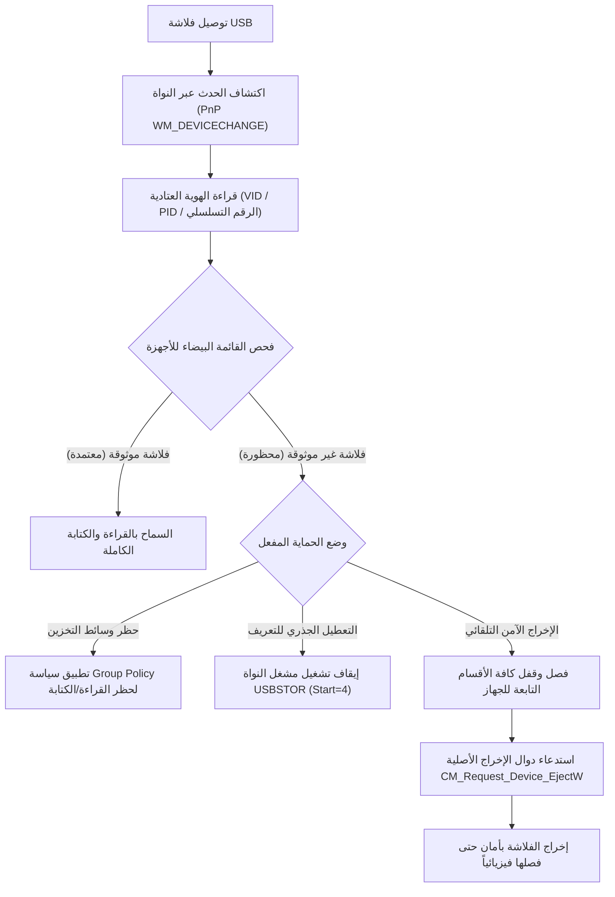

<p align="center">
  
</p>

<h1 align="center">USB Shield Pro</h1>

<p align="center">
  <strong>نظام متقدم لحماية منافذ وسائط التخزين USB والتحكم في عتاد التخزين الخارجي على نظام ويندوز</strong>
</p>

<p align="center">
  <a href="README.md"><strong>English</strong></a> &bull;
  <a href="README.ar.md"><strong>العربية</strong></a>
</p>

<p align="center">
  <a href="https://github.com/0x-Abood/USB-Shield-Pro/releases/tag/v2.1.0"></a>
  <a href="https://github.com/0x-Abood/USB-Shield-Pro/actions/workflows/ci.yml"></a>
  
  
  
  
  <a href="LICENSE"></a>
</p>

---

## نبذة عن المشروع

**USB Shield Pro** هو برنامج أمني متقدم ومفتوح المصدر لحماية أجهزة الكمبيوتر ومحطات العمل العاملة بنظام **ويندوز (Windows 10 و Windows 11)** من المخاطر الأمنية المرتبطة بمنافذ ووسائط تخزين USB، مثل تسريب البيانات وهجمات الفلاشات الخبيثة (BadUSB والبرمجيات ذاتية التشغيل).

يعمل البرنامج مباشرة على مستوى تعريفات النواة (Kernel Driver `USBSTOR`) ونظام إدارة الأجهزة (Plug-and-Play)، مما يتيح تطبيق سياسة "الحظر الافتراضي" (Default-Deny) على وسائط التخزين، مع السماح للفلاشات المعتمدة فقط بالعمل عبر القائمة البيضاء المستندة إلى الأرقام التسلسلية للعتاد (Hardware Serial Number).

---

## واجهة المستخدم (User Interface)

<p align="center">
  
  
</p>
<p align="center">
  
  
</p>
<p align="center">
  
  
</p>

---

## المميزات الرئيسية

- **القائمة البيضاء العتادية (Hardware Whitelisting):** السماح فقط للفلاشات والأقراص الموثوقة بالعمل عبر مطابقة رقمها التسلسلي الفريد ومعرفات الشركة المصنعة (`VID/PID`).
- **محرك الإخراج الآمن للأقسام المتعددة (Multi-Partition Safe Eject):** حل هندسي متكامل لإخراج الفلاشات المقسمة (مثل فلاشات **Ventoy** والأقراص المتعددة الأقسام) دون أخطاء `PNP_VetoDevice`.
- **معمارية أصلية نظيفة ومتوافقة مع مضادات الفيروسات (Zero-Dropper):** لا يقوم البرنامج بإنشاء أو تنفيذ أي ملفات باتش مؤقتة (`.bat` / `.cmd` / `.ps1`)، وتتم إدارة خدمة الويندوز مباشرة عبر دوال `advapi32.dll` بدون أوامر `sc.exe` الخلفية.
- **خدمة نظام خلفية تعمل على مدار الساعة (Windows Service):** حماية مستمرة حتى قبل تسجيل دخول المستخدم لشاشة القفل عبر خدمة النظام `UsbShieldService`.
- **حماية الأقراص الأساسية (Fail-Closed System Floor):** خط أمان صارم يمنع حظر أو إخراج القرص 0 أو قسم الويندوز أو ملف الذاكرة الافتراضية (`pagefile.sys`).
- **استعادة الإعدادات الأصلية بضغطة زر (Disaster Recovery):** تسجيل إعدادات النظام الأصلية قبل أي تعديل لتمكين استعادتها فورياً بنقرة واحدة أو عبر سطر الأوامر (`--restore-defaults`).
- **واجهة مستخدم عربية بالكامل:** دعم أصلي وكامل للغة العربية (RTL) مع شاشات عالية الدقة (High-DPI 100%–200%) بالوضعين الداكن والفاتح.

---

## مخطط تدفق الحماية (Architecture Workflow)



---

## جدول القدرات الأمنية

| الميزة الأمنية | الآلية التقنية | القيمة الأمنية |
| :--- | :--- | :--- |
| **التعطيل الجذري للمشغل** | `USBSTOR\Start = 4` | إيقاف تعريف التخزين بالكامل على مستوى نواة النظام. |
| **حظر وسائط التخزين** | `RemovableStorageDevices\Deny_All` | منع أي قراءة أو كتابة على وسائط التخزين الخارجية. |
| **وضع الحماية من الكتابة** | `StorageDevicePolicies\WriteProtect = 1` | تصفح محتوى الفلاشة للقراءة فقط ومنع نقل البيانات إليها. |
| **حظر الأجهزة المحمولة** | `WPD Devices\Deny_Read / Deny_Write` | حظر نقل الملفات عبر الهواتف الذكية والكاميرات (MTP/PTP). |
| **منع تثبيت الأجهزة** | `DeviceInstall\Restrictions\DenyRemovableDevices` | منع تثبيت تعريفات أجهزة التخزين القابلة للإزالة. |
| **تعطيل التشغيل التلقائي** | `NoDriveTypeAutoRun = 0xFF` | تحييد ثغرات التشغيل التلقائي بمجرد توصيل الفلاشة. |
| **الإخراج الآمن المتعدد** | `FSCTL_LOCK` &larr; `FSCTL_DISMOUNT` &larr; `CM_Request_Device_EjectW` | إخراج الفلاشات المقسمة وحماية البيانات من التلف. |
| **خدمة الويندوز الأصلية** | `advapi32.dll` المباشرة | استمرار الحماية بدون الحاجة لبقاء واجهة البرنامج مفتوحة. |
| **حماية قرص النظام** | حظر إخراج القرص 0 وأقسام الإقلاع | منع أي مساس بملفات نظام التشغيل أو أقراص الويندوز. |
| **الأمان التشفيري** | PBKDF2 (HMAC-SHA256) + DPAPI | حماية لوحة التحكم بكلمة مرور رئيسية ومفتاح استرداد 128 بت. |

---

## روابط التحميل المباشرة

| الحزمة | الصيغة | الحجم | رابط التحميل | فحص الحماية والنزاهة |
| :--- | :--- | :--- | :--- | :--- |
| **المثبت التلقائي** | `.exe` | `1,237,504 بايت` | [تحميل Setup.exe](https://github.com/0x-Abood/USB-Shield-Pro/releases/download/v2.1.0/USB-Shield-Pro-v2.1.0-Setup.exe) | [تقرير VirusTotal نظيف (0/72)](https://www.virustotal.com/gui/file/a8e0db5305cd3099d0f0580b5eb5a97e54ce7352e108c199b6532cf85a203cdc) |
| **النسخة المحمولة** | `.zip` | `383,102 بايت` | [تحميل Portable.zip](https://github.com/0x-Abood/USB-Shield-Pro/releases/download/v2.1.0/USB-Shield-Pro-v2.1.0-Portable.zip) | [تقرير VirusTotal نظيف (0/72)](https://www.virustotal.com/gui/file/64c525ce05419592516eae76faa8a680df14d024d6b05bebcb4bf2300b0102ad) |
| **ملف البصمات** | `.txt` | `2,811 بايت` | [تحميل ملف البصمات SHA-256](https://github.com/0x-Abood/USB-Shield-Pro/releases/download/v2.1.0/USB-Shield-Pro-v2.1-SHA256.txt) | يتم التحقق عبر `verify-release.ps1` |

---

## أوامر سطر الأوامر (CLI) والاستعادة

```cmd
:: تشغيل واجهة البرنامج الرسومية (الافتراضي)
UsbShieldPro.exe

:: تشغيل فحص تشخيصي سريع للأجهزة المتصلة
UsbShieldPro.exe --diag-detect

:: تشغيل الحماية كخدمة خلفية لويندوز
UsbShieldPro.exe --service

:: استعادة إعدادات النظام الأصلية بالكامل (استعادة الطوارئ)
UsbShieldPro.exe --restore-defaults

:: استعادة دقيقة ومطابقة من سجل التغييرات
UsbShieldPro.exe --restore-exact
```

---

## جدول البصمات الرقمية الرسمية (SHA-256)

تم بناء جميع الملفات التنفيذية ببيئة نظيفة وخالية تماماً من الرموز البرمجية التصحيحية أو المسارات المحلية (`/optimize+ /debug-`).

| اسم الملف | النوع | الحجم (بايت) | بصمة SHA-256 الرسمية |
| :--- | :--- | :--- | :--- |
| **`USB-Shield-Pro-v2.1.0-Setup.exe`** | مثبت الإعداد | `1,237,504` | `A8E0DB5305CD3099D0F0580B5EB5A97E54CE7352E108C199B6532CF85A203CDC` |
| **`USB-Shield-Pro-v2.1.0-Portable.zip`** | حزمة محمولة | `383,102` | `64C525CE05419592516EAE76FAA8A680DF14D024D6B05BEBCB4BF2300B0102AD` |
| **`UsbShieldPro.exe`** | ملف تنفيذي مستقل | `1,060,864` | `4F9A904E9AB5236C18D298DD78443D5021DB5781BFCF16C0C037100DFEC5AFA9` |
| **`UsbShieldPro.exe.config`** | ضبط الشاشات | `598` | `53840DABDB7510AC21965024AEC4797025C920C965D29BBAA46FFA324338C5B1` |
| **`README.txt`** | ملاحظات الإصدار | `6,998` | `3B72B744C64DF260E54BBC5AE5B0888C9F742C320DB3C62C9D26D5CBC1DAEA4F` |

### أداة التحقق التلقائية (PowerShell Script):
يمكنك التحقق من سلامة ومطابقة الملف المحمل عبر سكربت الفحص المرفق بأمر واحد:
```powershell
powershell -ExecutionPolicy Bypass -File .\verify-release.ps1 -FilePath ".\USB-Shield-Pro-v2.1.0-Setup.exe"
```

أو التحقق اليدوي المباشر عبر أمر PowerShell المدمج:
```powershell
Get-FileHash -Path ".\USB-Shield-Pro-v2.1.0-Setup.exe" -Algorithm SHA256
```

---

## البناء من المصدر (Building from Source)

### متطلبات التشغيل:
- نظام Windows 10 (v1903+) أو Windows 11 (64-bit)
- حزمة Microsoft .NET Framework 4.8 (مترجم `csc.exe` متوفر افتراضياً في نظام ويندوز داخل مسار `%SystemRoot%\Microsoft.NET\Framework64\v4.0.30319`)

### خطوات البناء:
1. استنساخ المستودع:
   ```cmd
   git clone https://github.com/0x-Abood/USB-Shield-Pro.git
   cd USB-Shield-Pro
   ```
2. بناء البرنامج التنفيذي وأداة الاختبارات:
   ```cmd
   build.bat
   ```
3. بناء برنامج التثبيت الذاتي:
   ```cmd
   Installer\build_installer.bat
   ```
4. تشغيل حزمة اختبارات الأتمتة الشاملة (27 جناح اختبار، 347 تأكيداً):
   ```cmd
   TestRunner.exe --test-harness
   ```

---

## الرخصة وحقوق المطور

البرنامج منشور تحت **رخصة MIT**. راجع ملف [`LICENSE`](LICENSE) للتفاصيل الكاملة.

تم التطوير بـ &hearts; بواسطة **0xAbood**  
المستودع الرسمي للمشروع: [https://github.com/0x-Abood/USB-Shield-Pro](https://github.com/0x-Abood/USB-Shield-Pro)
