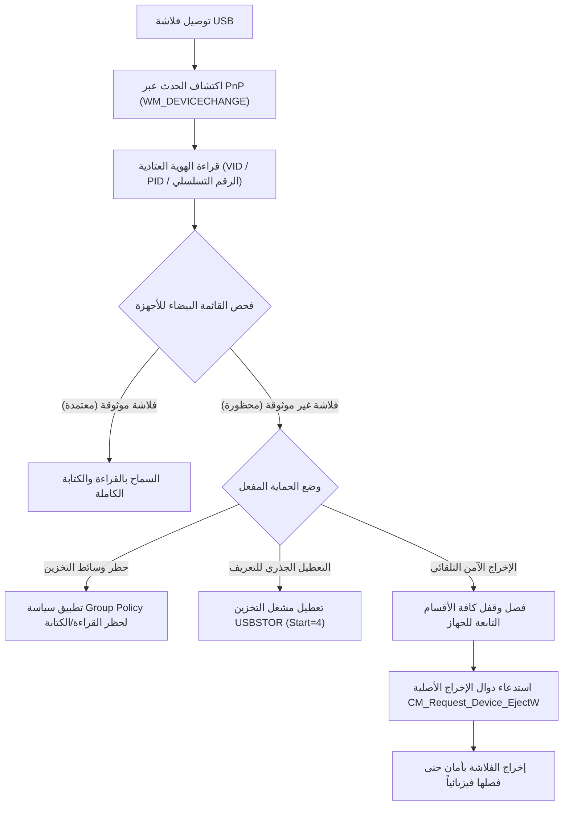

<p align="center">
  
</p>

<h1 align="center">USB Shield Pro</h1>

<p align="center">
  <strong>أداة برمجية جاهزة للإنتاج للتحكم في وسائط تخزين USB ومنافذ التخزين الخارجية على نظام ويندوز لمحطات العمل والمختبرات والبيئات الإدارية</strong>
</p>

<p align="center">
  <a href="README.md"><strong>English</strong></a> &bull;
  <a href="README.ar.md"><strong>العربية</strong></a>
</p>

<p align="center">
  <a href="https://github.com/0x-Abood/USB-Shield-Pro/releases/tag/v2.1.0"></a>
  <a href="https://github.com/0x-Abood/USB-Shield-Pro/actions/workflows/ci.yml"></a>
  
  
  
  <a href="LICENSE"></a>
</p>

---

## نبذة عن المشروع

**USB Shield Pro** هي أداة برمجية مفتوحة المصدر وجاهزة للبيئات التشغيلية والإنتاجية، مخصصة للتحكم في وسائط تخزين USB وأجهزة WPD/MTP على محطات العمل والمختبرات والبيئات الإدارية العاملة بنظام **ويندوز (Windows 10 و Windows 11)**. تهدف الأداة إلى توفير تحكم صارم في وسائط التخزين لحماية الأنظمة من محركات التخزين الخارجية غير المصرح بها، ومنع تسريب البيانات، وتعطيل برمجيات التشغيل التلقائي (AutoRun/AutoPlay).

تعمل الأداة عبر سياسات سجل النظام (Registry Policies) والتحكم في حالة مشغل التخزين (USBSTOR Driver-State Control) ونظام إدارة الأجهزة الأصلي (Plug-and-Play)، مما يتيح تطبيق سياسة "الحظر الافتراضي" (Default-Deny) على وسائط التخزين الخارجية مع السماح بالأجهزة المعتمدة حصراً عبر القائمة البيضاء المستندة إلى المعرفات العتادية (`VID` / `PID` / الرقم التسلسلي).

---

## نموذج التهديد والنطاق المعماري (Threat Model & Architecture Scope)

### نطاق التهديدات التي تعالجها الأداة
- **وسائط تخزين USB غير المصرح بها:** الحظر الاستباقي والإخراج الآمن التلقائي للفلاشات والأقراص الصلبة الخارجية وأقراص SSD الخارجية غير المصرح بها (`USBSTOR` و `UASP`).
- **تسريب وسرقة البيانات:** حظر نسخ ونقل البيانات عبر سياسات النظام (`StorageDevicePolicies\WriteProtect = 1` و `RemovableStorageDevices\Deny_Write`) لمنع تسريب البيانات والملفات مع إمكانية إتاحة القراءة فقط للفحص.
- **أجهزة الهواتف والوسائط المحمولة (WPD / MTP):** إغلاق قنوات نقل الملفات وتجاوز الحظر عبر بروتوكولات MTP و PTP المستخدمة في الهواتف الذكية والكاميرات عبر سياسات `WPD Devices\Deny_Read` و `Deny_Write`.
- **برمجيات التشغيل التلقائي:** تعطيل التشغيل التلقائي (AutoRun/AutoPlay) على كافة وسائط التخزين لحماية النظام من البرمجيات ذاتية التشغيل بمجرد توصيل الفلاشة (`NoDriveTypeAutoRun = 0xFF`).

### آلية عمل الأنماط وتفاعلها التقني
- **التعطيل الجذري للمشغل (`USBSTOR\Start = 4`):** يوقف تحميل مشغل التخزين القياسي `usbstor.sys` في ويندوز على مستوى النظام بالكامل. عند تفعيل هذا النمط، يتم فرض **وضع إغلاق شامل (System-Wide Lockdown)** يمنع كافة أجهزة التخزين الخارجية من العمل والتعريف، بما في ذلك الأجهزة المدرجة في القائمة البيضاء.
- **التعامل مع أقراص `UASP` مقابل `USBSTOR`:** تعتمد وسائط التخزين الحديثة فائقة السرعة USB 3.x ومحركات NVMe الخارجية على مشغل بروتوكول SCSI المرفق بـ USB (`uaspstor.sys`) بدلاً من `usbstor.sys`. وفي حين يستهدف خيار `Driver Start=4` مشغل `USBSTOR` القياسي مباشرة، يتم حظر وعزل وسائط `UASP` عبر طبقة سياسات حظر وسائط التخزين القابلة للإزالة (`RemovableStorageDevices\Deny_All`) ومحرك الإخراج الآمن اللحظي للأقسام (`FSCTL_LOCK_VOLUME` &larr; `FSCTL_DISMOUNT_VOLUME` &larr; `CM_Request_Device_EjectW`).
- **وضع الإغلاق الشامل مقابل وضع القائمة البيضاء:** تعمل سياسات الحظر الكلي على مستوى النظام (`USBSTOR Start=4` أو `RemovableStorageDevices\Deny_All`) كوضع إغلاق شامل للنظام بدون أي استثناءات للأجهزة. في المقابل، يعمل **وضع القائمة البيضاء (Allowlist Enforcement Mode)** عندما تكون المشغلات في الوضع التفاعلي (`Start = 3`): حيث تراقب الخدمة الخلفية المستقلة منافذ التوصيل لحظياً، وتتحقق من الهوية العتادية (`VID/PID/Serial`)، فتسمح للأجهزة الموثوقة بالبقاء متصلة، بينما تطرد الأجهزة غير الموثوقة فور توصيلها.
- **نافذة التعداد اللحظي والإخراج التفاعلي (Reactive Ejection & Enumeration Window):** في وضع القائمة البيضاء التفاعلي، يمر الجهاز غير الموثوق بنافذة تعداد قصيرة على مستوى نظام ويندوز (Windows PnP) قبل أن تلتقطه خدمة `UsbShieldService` وتبدأ تسلسل العزل. يتم تقليص مخاطر هذه النافذة هندسياً عبر:
  1. التعطيل الشامل للتشغيل التلقائي (`NoDriveTypeAutoRun = 0xFF`) لمنع تنفيذ أي كود برمجي تلقائياً عند التوصيل.
  2. القفل البرمجي للقسم (`FSCTL_LOCK_VOLUME`) قبل فصله، مما يقطع أي مسارات وصول للملفات ويمنع العمليات المشغلة في النظام من قراءة أو فتح ملفات من الوسيط أثناء تسلسل الطرد.
- **الحماية التشفيرية لمصادقة المسؤول:** يقتصر استخدام التشفير (`PBKDF2-HMAC-SHA256` و `Windows DPAPI`) على حماية مصادقة المسؤول على واجهة البرنامج، وتشفير الإعدادات المخزنة محلياً، وتوليد مفتاح الاسترداد 128 بت لضمان عدم التلاعب بالسياسات.

### القيود الفنية وخارج نطاق الأداة (Limitations & Out-of-Scope)
- **معمارية فضاء المستخدم (User-Mode Service):** تعمل الأداة كخدمة نظام في فضاء المستخدم وتنسق سياسات السجل وإدارة الأجهزة (Registry/PnP Policies)، وليست مشغل نواة منخفض المستوى من فئة (Kernel Minifilter Driver).
- **مقاومة العبث وصلاحيات مسؤول النظام (Tamper Resistance & Local Administrator Boundary):** تمنع حماية كلمة المرور (`PBKDF2 + DPAPI`) وتقييد أذونات السجل المستخدمين القياسيين (`Standard Users`) والمتسللين على الجلسات المفتوحة من تعديل أو تعطيل الحماية. ومع ذلك، وبطبيعة معمارية أمان ويندوز، فإن أي مستخدم يمتلك صلاحيات مسؤول محلي كاملة (`Local Administrator / SYSTEM`) يمتلك القدرة المعمارية الجذرية على إيقاف الخدمات أو تعديل مفاتيح السجل.
- **التعايش مع بيئات الدومين المؤسسية (Active Directory GPO / Microsoft Intune):** تدير الأداة سياسات السجل المحلية للجهاز (`Local Machine Policies`). في بيئات العمل المؤسسية المدارة بواسطة `Domain GPO` أو `Intune`، قد تقوم سياسات الدومين بالكتابة فوق السياسات المحلية عند تحديث السياسات الدوري (`gpupdate /force`).
- **أجهزة الإدخال وهجمات BadUSB (HID Keyboard Emulation):** العتاد الخبيث الذي يُعرّف نفسه كوحدة إدخال مفاتيح (مثل هجمات BadUSB أو أجهزة Rubber Ducky) لا يقوم بتحميل مشغل التخزين `USBSTOR` ويقع خارج نطاق أدوات التحكم في وسائط التخزين. التصدي لهذه الهجمات يتطلب أقفالاً فيزيائية للمنافذ أو حلول تحكم على مستوى أجهزة HID.
- **تزوير المعرفات العتادية (Hardware Identifier Spoofing):** تعتمد القائمة البيضاء على المعرفات العتادية المصرح بها من قِبل وحدة التحكم في الجهاز. إذا تم استخدام شريحة ميكروكنترولر برمجية قابلة للتهيئة لنسخ نفس الـ `VID/PID` والرقم التسلسلي لجهاز موثوق، فلا يمكن تمييزها على مستوى استعلام فضاء المستخدم دون مصادقة تشفيرية على مستوى العتاد.

---

## المميزات الرئيسية

- **القائمة البيضاء للمعرفات العتادية (VID/PID/Serial):** السماح فقط للفلاشات والأقراص الموثوقة بالعمل عبر مطابقة رقمها التسلسلي الفريد ومعرفات الشركة المصنعة والمنتج (`VID/PID`).
- **محرك الإخراج الآمن للأقسام المتعددة (Multi-Partition Safe Eject):** حل هندسي متكامل لإخراج الفلاشات المقسمة (مثل فلاشات **Ventoy** والأقراص المتعددة الأقسام) دون أخطاء `PNP_VetoDevice`.
- **التكامل المباشر مع واجهة Win32 SCM (بدون أي عمليات فرعية):** تشغيل نظيف دون إنشاء أو تنفيذ أي ملفات باتش أو سكربتات (`.bat` أو `.cmd` أو `.ps1`). تتم إدارة دورة حياة خدمة الويندوز مباشرة عبر دوال Win32 الأصلية في `advapi32.dll` (مثل `OpenSCManagerW` و `CreateServiceW` و `DeleteService`) دون تشغيل أي عمليات فرعية أو نوافذ أوامر خارجية (`sc.exe` أو `cmd.exe`).
- **خدمة نظام خلفية تعمل على مدار الساعة (Windows Service):** حماية مستمرة حتى قبل تسجيل دخول المستخدم لشاشة القفل عبر خدمة النظام `UsbShieldService`.
- **حماية الأقراص الأساسية (Fail-Closed System Floor):** خط أمان صارم يمنع حظر أو إخراج القرص 0 أو قسم الويندوز أو ملف الذاكرة الافتراضية (`pagefile.sys`).
- **استعادة الإعدادات الأصلية بضغطة زر (Disaster Recovery):** تسجيل إعدادات النظام الأصلية قبل أي تعديل لتمكين استعادتها فورياً بنقرة واحدة أو عبر سطر الأوامر (`--restore-defaults`).
- **واجهة مستخدم عربية بالكامل:** دعم أصلي وكامل للغة العربية (RTL) مع شاشات عالية الدقة (High-DPI 100%–200%) بالوضعين الداكن والفاتح.

---

## واجهة المستخدم (User Interface)

<p align="center">
  
  
</p>
<p align="center">
  
  
</p>
<p align="center">
  
  
</p>

---

## مخطط تدفق الحماية (Architecture Workflow)



---

## جدول القدرات الأمنية

| الميزة الأمنية | الآلية التقنية | القيمة الأمنية |
| :--- | :--- | :--- |
| **التعطيل الجذري للمشغل** | `USBSTOR\Start = 4` | إيقاف تعريف التخزين بالكامل على مستوى مشغل التخزين في النظام. |
| **حظر وسائط التخزين** | `RemovableStorageDevices\Deny_All` | منع أي قراءة أو كتابة على وسائط التخزين الخارجية. |
| **وضع الحماية من الكتابة** | `StorageDevicePolicies\WriteProtect = 1` | تصفح محتوى الفلاشة للقراءة فقط ومنع نقل البيانات إليها. |
| **حظر الأجهزة المحمولة** | `WPD Devices\Deny_Read / Deny_Write` | حظر نقل الملفات عبر الهواتف الذكية والكاميرات (MTP/PTP). |
| **منع تثبيت الأجهزة** | `DeviceInstall\Restrictions\DenyRemovableDevices` | منع تثبيت تعريفات أجهزة التخزين القابلة للإزالة. |
| **تعطيل التشغيل التلقائي** | `NoDriveTypeAutoRun = 0xFF` | تحييد ثغرات التشغيل التلقائي بمجرد توصيل الفلاشة. |
| **الإخراج الآمن المتعدد** | `FSCTL_LOCK` &larr; `FSCTL_DISMOUNT` &larr; `CM_Request_Device_EjectW` | إخراج الفلاشات المقسمة وحماية البيانات من التلف. |
| **خدمة الويندوز الأصلية** | `advapi32.dll` المباشرة | استمرار الحماية بدون الحاجة لبقاء واجهة البرنامج مفتوحة وبدون نوافذ أوامر فرعية. |
| **حماية قرص النظام** | حظر إخراج القرص 0 وأقسام الإقلاع | منع أي مساس بملفات نظام التشغيل أو أقراص الويندوز. |
| **الأمان التشفيري** | PBKDF2 (HMAC-SHA256) + DPAPI | تأمين مصادقة المسؤول على واجهة البرنامج وتعديل السياسات ومفتاح الاسترداد 128 بت. |

---

## روابط التحميل المباشرة

| الحزمة | الصيغة | الحجم | رابط التحميل | فحص الحماية والنزاهة |
| :--- | :--- | :--- | :--- | :--- |
| **المثبت التلقائي** | `.exe` | `1,237,504 بايت` | [تحميل Setup.exe](https://github.com/0x-Abood/USB-Shield-Pro/releases/download/v2.1.0/USB-Shield-Pro-v2.1.0-Setup.exe) | [تقرير VirusTotal نظيف (0/72)](https://www.virustotal.com/gui/file/a8e0db5305cd3099d0f0580b5eb5a97e54ce7352e108c199b6532cf85a203cdc) |
| **النسخة المحمولة** | `.zip` | `383,102 بايت` | [تحميل Portable.zip](https://github.com/0x-Abood/USB-Shield-Pro/releases/download/v2.1.0/USB-Shield-Pro-v2.1.0-Portable.zip) | [تقرير VirusTotal نظيف (0/72)](https://www.virustotal.com/gui/file/64c525ce05419592516eae76faa8a680df14d024d6b05bebcb4bf2300b0102ad) |
| **ملف البصمات** | `.txt` | `2,811 بايت` | [تحميل ملف البصمات SHA-256](https://github.com/0x-Abood/USB-Shield-Pro/releases/download/v2.1.0/USB-Shield-Pro-v2.1-SHA256.txt) | التحقق عبر `Get-FileHash` في PowerShell |

---

## أوامر سطر الأوامر (CLI) والاستعادة

```cmd
:: تشغيل واجهة البرنامج الرسومية (الافتراضي)
UsbShieldPro.exe

:: تشغيل فحص تشخيصي سريع للأجهزة المتصلة
UsbShieldPro.exe --diag-detect

:: تشغيل الحماية كخدمة خلفية لويندوز
UsbShieldPro.exe --service

:: استعادة إعدادات النظام الأصلية بالكامل (استعادة الطوارئ)
UsbShieldPro.exe --restore-defaults

:: استعادة دقيقة ومطابقة من سجل التغييرات
UsbShieldPro.exe --restore-exact
```

---

## جدول البصمات الرقمية الرسمية (SHA-256)

تم بناء جميع الملفات التنفيذية ببيئة نظيفة وخالية تماماً من الرموز البرمجية التصحيحية أو المسارات المحلية (`/optimize+ /debug-`).

| اسم الملف | النوع | الحجم (بايت) | بصمة SHA-256 الرسمية |
| :--- | :--- | :--- | :--- |
| **`USB-Shield-Pro-v2.1.0-Setup.exe`** | مثبت الإعداد | `1,237,504` | `A8E0DB5305CD3099D0F0580B5EB5A97E54CE7352E108C199B6532CF85A203CDC` |
| **`USB-Shield-Pro-v2.1.0-Portable.zip`** | حزمة محمولة | `383,102` | `64C525CE05419592516EAE76FAA8A680DF14D024D6B05BEBCB4BF2300B0102AD` |
| **`UsbShieldPro.exe`** | ملف تنفيذي مستقل | `1,060,864` | `4F9A904E9AB5236C18D298DD78443D5021DB5781BFCF16C0C037100DFEC5AFA9` |
| **`UsbShieldPro.exe.config`** | ضبط الشاشات | `598` | `53840DABDB7510AC21965024AEC4797025C920C965D29BBAA46FFA324338C5B1` |
| **`README.txt`** | ملاحظات الإصدار | `6,998` | `3B72B744C64DF260E54BBC5AE5B0888C9F742C320DB3C62C9D26D5CBC1DAEA4F` |

### التحقق من النزاهة الرقمية (PowerShell)

> [!NOTE]
> الحزم التنفيذية الرسمية منشورة كـ **إصدار مفتوح المصدر غير موقع بشهادة Authenticode تجارية** (Unsigned Open-Source Release). لذلك يُنصح بشدة بالتحقق من مطابقة بصمات `SHA-256` المنشورة قبل التثبيت.

يمكنك التحقق من سلامة ومطابقة الملفات المحملة مباشرة عبر أمر PowerShell المدمج:

```powershell
# التحقق من مثبت الإعداد
Get-FileHash .\release\USB-Shield-Pro-v2.1.0-Setup.exe -Algorithm SHA256

# التحقق من النسخة المحمولة
Get-FileHash .\release\USB-Shield-Pro-v2.1.0-Portable.zip -Algorithm SHA256
```

---

## البناء من المصدر (Building from Source)

### متطلبات التشغيل:
- نظام Windows 10 (v1903+) أو Windows 11 (64-bit)
- حزمة Microsoft .NET Framework 4.8 (مترجم `csc.exe` متوفر افتراضياً في نظام ويندوز داخل مسار `%SystemRoot%\Microsoft.NET\Framework64\v4.0.30319`)

### خطوات البناء:
1. استنساخ المستودع:
   ```cmd
   git clone https://github.com/0x-Abood/USB-Shield-Pro.git
   cd USB-Shield-Pro
   ```
2. بناء البرنامج التنفيذي وأداة الاختبارات:
   ```cmd
   build.bat
   ```
3. بناء برنامج التثبيت الذاتي:
   ```cmd
   Installer\build_installer.bat
   ```
4. تشغيل حزمة اختبارات الأتمتة الشاملة (27 جناح اختبار، 347 تأكيداً):
   ```cmd
   TestRunner.exe --test-harness
   ```

---

## الرخصة وحقوق المطور

البرنامج منشور تحت **رخصة MIT**. راجع ملف [`LICENSE`](LICENSE) للتفاصيل الكاملة.

تم التطوير بـ &hearts; بواسطة **0xAbood**  
المستودع الرسمي للمشروع: [https://github.com/0x-Abood/USB-Shield-Pro](https://github.com/0x-Abood/USB-Shield-Pro)
