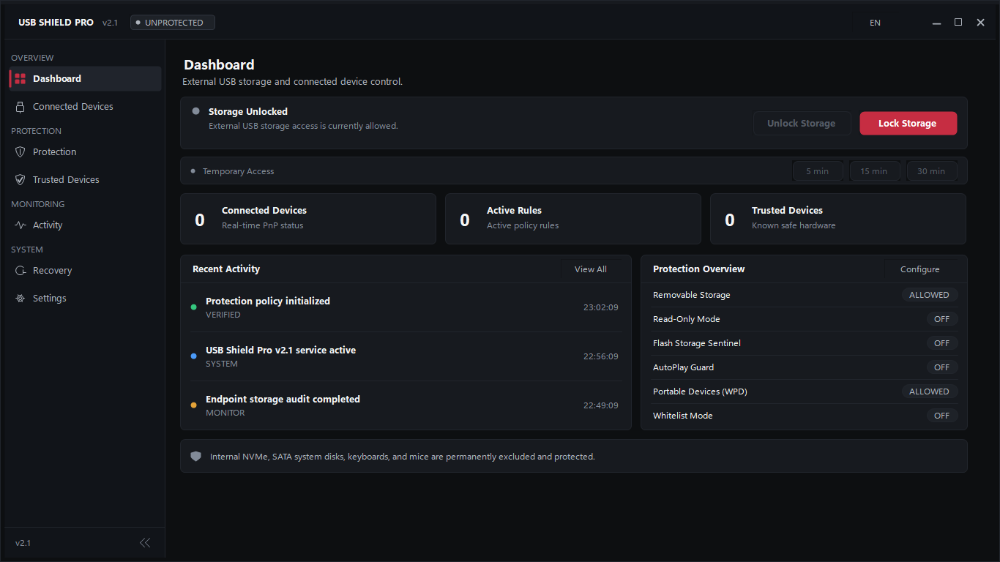
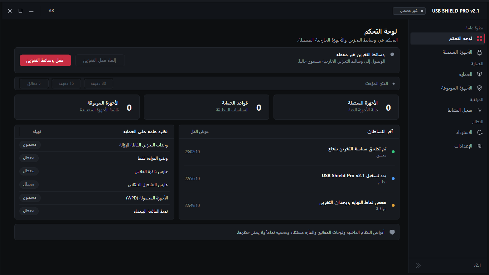
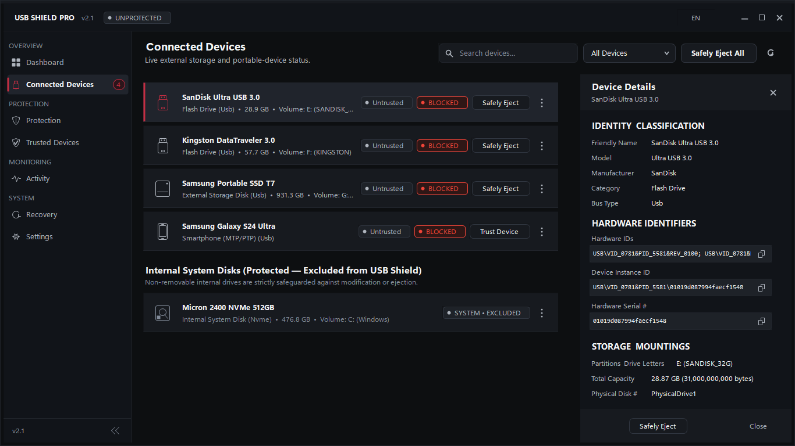
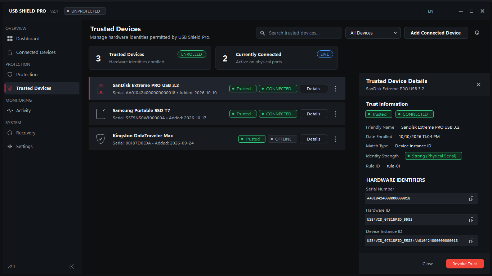
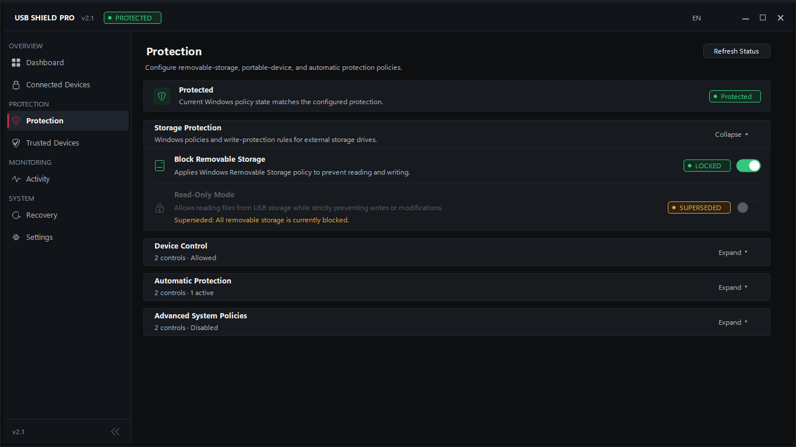
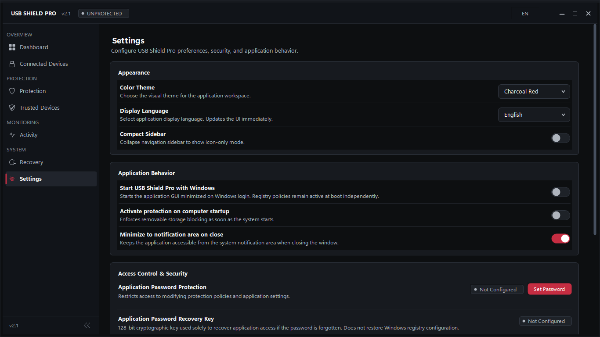

<p align="center">
  
</p>

<h1 align="center">USB Shield Pro</h1>

<p align="center">
  <strong>Production-ready Windows USB storage control utility for workstations, labs, and administrative environments</strong>
</p>

<p align="center">
  <a href="README.md"><strong>English</strong></a> &bull;
  <a href="README.ar.md"><strong>العربية</strong></a>
</p>

<p align="center">
  <a href="https://github.com/0x-Abood/USB-Shield-Pro/releases/tag/v2.1.0"></a>
  <a href="https://github.com/0x-Abood/USB-Shield-Pro/actions/workflows/ci.yml"></a>
  
  
  
  <a href="LICENSE"></a>
</p>

---

## Overview

**USB Shield Pro** is an open-source, production-ready Windows USB storage control utility engineered for Windows 10 and 11 workstations, labs, and administrative environments. It provides dedicated **USB Mass Storage & WPD/MTP Endpoint Control** to protect systems against unauthorized USB storage peripherals, data exfiltration, and automated drive-by payloads.

USB Shield Pro operates through two distinct, complementary enforcement models:

1. **System-Wide Lockdown (Pre-Mount Block):** Proactive, global pre-mount restriction that disables USB storage enumeration entirely at the driver layer (`USBSTOR\Start = 4`) and enforces Windows Group Policy boundaries (`RemovableStorageDevices\Deny_All`), blocking all removable storage devices machine-wide without allowlist exceptions.
2. **Reactive Allowlist Enforcement (Detect-and-Eject):** Real-time hardware identity verification (`VID`/`PID`/`Serial`) managed by the autonomous `UsbShieldService` daemon (`Start = 3`). Approved peripherals remain mounted, while unapproved devices are immediately isolated and ejected via synchronized multi-partition dismounting upon connection.

---

## Threat Model & Architecture Scope

### Protected Attack Vectors
- **Unauthorized Removable Storage Peripherals:** Enforces default-deny isolation and reactive safe ejection against unapproved USB flash drives, external HDDs, and external SSDs (`USBSTOR` and `UASP`).
- **Storage-Based Data Exfiltration:** Restricts file writes via Windows Group Policy (`StorageDevicePolicies\WriteProtect = 1` and `RemovableStorageDevices\Deny_Write`), preventing unauthorized data theft while optionally preserving read-only file inspection.
- **Smartphone & Media Device Transfer Channels (WPD / MTP):** Eliminates secondary MTP and PTP file transfer bypass channels utilized by smartphones, portable digital cameras, and media players via `WPD Devices\Deny_Read` and `Deny_Write`.
- **Automated Drive-by Payloads (AutoRun / AutoPlay):** Suppresses AutoRun and AutoPlay execution across all removable media types (`NoDriveTypeAutoRun = 0xFF`), eliminating automated payload triggers upon device insertion.

### Enforcement Modes & Technical Interactions
- **System-Wide Driver Hard Block (`USBSTOR\Start = 4`):** Disables storage device enumeration at the Windows driver initialization layer for standard `usbstor.sys`. When active, this operates as a **System-Wide Lockdown** where all standard USB mass storage devices—including those on the allowlist—are blocked from enumerating.
- **UASP vs. USBSTOR Driver Boundary:** Modern high-speed USB 3.x and external NVMe storage enclosures frequently bind to the USB Attached SCSI Protocol driver (`uaspstor.sys`) rather than `usbstor.sys`. While `Driver Start=4` directly targets `USBSTOR`, UASP peripherals are governed, blocked, and quarantined through the higher-level Removable Storage Access policy layer (`RemovableStorageDevices\Deny_All`) and the real-time volume dismount/PnP ejection engine (`FSCTL_LOCK_VOLUME` &rarr; `FSCTL_DISMOUNT_VOLUME` &rarr; `CM_Request_Device_EjectW`).
- **Lockdown Modes vs. Allowlist Enforcement Mode:** System-wide blocking policies (`USBSTOR\Start = 4` or `RemovableStorageDevices\Deny_All`) enforce a global, blanket restriction across the entire workstation without device-level exceptions. Conversely, **Allowlist Enforcement Mode** operates when storage drivers remain interactive (`Start = 3`): the background daemon monitors bus arrivals, verifies hardware identities (`VID`/`PID`/`Serial`), permits trusted hardware to stay mounted, and programmatically ejects untrusted devices immediately upon connection.
- **Reactive Ejection & The Enumeration Window:** In interactive Allowlist Enforcement Mode, an untrusted peripheral undergoes a brief hardware enumeration window at the Windows PnP subsystem layer before `UsbShieldService` captures the arrival event, validates identity, and triggers isolation. This window is defensively mitigated by:
  1. Completely disabling AutoRun/AutoPlay (`NoDriveTypeAutoRun = 0xFF`) to prevent automatic code execution upon arrival.
  2. Sequential Volume Lock and Forceful Dismount Fallback: The ejection engine first attempts an exclusive volume lock via `FSCTL_LOCK_VOLUME` (with up to 3 consecutive retries). If locking fails due to open handles from active background processes (such as Windows Search indexing or antivirus scanning), the engine deterministically falls back to `FSCTL_DISMOUNT_VOLUME`, which forcefully invalidates and severs all open file handles before invoking `IOCTL_STORAGE_EJECT_MEDIA` and `CM_Request_Device_EjectW`, ensuring running applications cannot read or access files during device teardown.
- **Administrative & State Cryptography:** Cryptographic algorithms are strictly dedicated to administrative authentication, state integrity, and disaster recovery: master passwords are keyed using PBKDF2 with HMAC-SHA256, local configuration data is encrypted with Windows DPAPI, and offline emergency recovery utilizes 128-bit cryptographic key representations.

### Known Limitations & Out-of-Scope Vectors
- **User-Mode Architecture:** USB Shield Pro operates as a user-mode Windows service (`UsbShieldService`) and registry/PnP policy coordinator, **not** as a kernel-mode filesystem minifilter driver.
- **Mount-Time Filesystem Parsing:** In reactive allowlist mode, Windows briefly mounts and parses filesystem headers and metadata (directory structures, volume labels, indexing caches) before reactive ejection completes. While this mode reliably prevents file copying, persistent execution, and data exfiltration, it does not defend against transient kernel-level filesystem driver parsing vulnerabilities triggered instantaneously upon mount.
- **UASP Fixed-Disk Enclosures:** Certain high-speed USB 3.x and external NVMe enclosures report to Windows as "Fixed Disks" (Basic Disks) rather than "Removable Media". These enclosures can bypass registry-based `RemovableStorageDevices` policies and rely strictly on `UsbShieldService`'s devnode detection and reactive dismount/ejection engine.
- **Blank or Non-Unique Hardware Serial Numbers:** Low-cost, counterfeit, or promotional USB flash drives occasionally possess blank or duplicate factory serial numbers. USB Shield Pro handles these by combining `VID` + `PID` + hardware instance profile; however, separate drives from the exact same manufacturing batch sharing identical hardware strings cannot be distinguished at the bus query layer.
- **Tamper Resistance & Local Administrator Boundary:** Administrative password protection (`PBKDF2 + DPAPI`) and registry ACL restrictions protect against standard, unprivileged users (`Standard Users`) and unauthorized modifications in unlocked console sessions. However, within the Windows security architecture, any user with elevated local administrator privileges (`Local Administrator / SYSTEM`) possesses the inherent architectural authority to terminate services, modify registry permissions, or bypass user-mode controls.
- **Enterprise Policy Coexistence (Active Directory GPO / Microsoft Intune):** USB Shield Pro configures and manages Local Machine Policies (`HKLM`). In managed enterprise domains, centralized Domain Group Policies (GPO) or Microsoft Intune profiles configured to enforce conflicting storage policies may overwrite local registry settings during periodic background policy refresh cycles (`gpupdate /force`).
- **Human Interface Devices (HID / BadUSB Injections):** Malicious hardware implants that present themselves as keyboard or mouse controllers (such as Rubber Ducky or BadUSB microcontrollers) load HID drivers rather than `USBSTOR` and are strictly outside the operational scope of storage controllers. Mitigating rogue HID devices requires physical USB port locks or bus-level device class filters.
- **Hardware Identifier Spoofing:** Allowlisting is based on vendor-reported hardware descriptors (`VID`, `PID`, and serial number). Hardware microcontrollers specifically programmed to duplicate the exact descriptors and serial string of an enrolled drive cannot be distinguished at the user-mode bus query layer without hardware-level cryptographic attestation.
- **Automated CI Test Harness Scope:** The automated CI test suite running on GitHub Actions (27 suites / 347 assertions) validates rules engine logic, atomic registry transaction safety, state journal rollback consistency, installer packaging, and Disk 0 safety invariants programmatically (Unit & Integration Logic). It does not emulate physical USB hardware bus signaling on virtualized cloud runner instances.

---

## Key Features

- **Hardware Identifier Allowlisting (VID/PID/Serial):** Grant access exclusively to approved flash drives and external disks by matching hardware serial numbers, vendor IDs, and product IDs.
- **Multi-Partition Safe Eject:** Engineered to reliably dismount and eject partitioned drives (e.g., Ventoy multi-boot drives, EFI system partitions, Windows To Go) without `PNP_VetoDevice` errors.
- **Native Win32 SCM API Integration (Zero Subprocess Spawning):** Clean execution with zero script generation (`.bat`, `.cmd`, `.ps1`). Service lifecycle operations run directly through native Win32 `advapi32.dll` APIs (`OpenSCManagerW`, `CreateServiceW`, `OpenServiceW`, `DeleteService`) without spawning external subprocesses (`sc.exe` / `cmd.exe`).
- **Autonomous Windows Service:** 24/7 background enforcement daemon (`UsbShieldService`) that monitors hardware arrival events and applies security boundaries even before a user logs in.
- **Fail-Closed Safety Invariant:** Physical Disk 0, Windows boot drives, and active paging file volumes are hard-coded as protected system boundaries that can never be locked or ejected.
- **Disaster Recovery Baseline:** Atomic state recording captures the exact pre-Shield system configuration, enabling instant rollback via GUI or CLI (`--restore-defaults`).
- **Bilingual High-DPI Interface:** Native English (LTR) and Arabic (RTL) desktop UI with complete Right-to-Left layout mirroring and full PerMonitorV2 High-DPI support (100% to 200%).

---

## User Interface

<p align="center">
  
  
</p>
<p align="center">
  
  
</p>
<p align="center">
  
  
</p>

---

## Technical Architecture

```mermaid
flowchart TD
    subgraph ModeA ["Mode A: System-Wide Lockdown (Pre-Mount Block)"]
        A1["USB Storage Connected"] --> A2{"Driver / Policy State"}
        A2 -- "USBSTOR Start = 4" --> A3["Driver Enumeration Disabled at Kernel Layer"]
        A2 -- "RemovableStorage Deny_All" --> A4["Windows Group Policy Blocks All Storage Access"]
        A3 --> A5["All Devices Blocked Without Allowlist Evaluation"]
        A4 --> A5
    end

    subgraph ModeB ["Mode B: Reactive Allowlist Mode (Detect & Eject - Start=3)"]
        B1["USB Storage Connected"] --> B2["PnP Subsystem Event (WM_DEVICECHANGE)"]
        B2 --> B3{"System Safety Floor Guard"}
        B3 -- "System Disk / Disk 0 / Boot" --> B4["Hard Floor Pass: Protected Machine Volume"]
        B3 -- "Removable / External Peripheral" --> B5["Hardware Identity Resolver (VID / PID / Serial)"]
        B5 --> B6{"RuleEngine Allowlist Match"}
        B6 -- "Trusted (Allowlisted)" --> B7["Permit Read / Write File Access"]
        B6 -- "Untrusted (Non-Allowlisted)" --> B8["Sequential Volume Lock & Dismount (FSCTL)"]
        B8 --> B9["Native CM_Request_Device_EjectW"]
        B9 --> B10["Device Safely Ejected Until Re-plugged"]
    end
```



---

## Core Security Capabilities

| Capability | Mechanism | Covers UASP (`uaspstor.sys`)? | Allows Trusted Drives? | Security Value |
| :--- | :--- | :--- | :--- | :--- |
| **Driver Hard Lock** | `USBSTOR\Start = 4` | **No** *(usbstor.sys only)* | **No** *(blocks all USBSTOR)* | Disables USB storage enumeration at the driver layer machine-wide. |
| **Removable Storage Deny** | `RemovableStorageDevices\Deny_All` | **Partial** *(covers removable UASP; fixed enclosures require service eject)* | **No** *(blocks all removable)* | Enforces Windows Group Policy to block read/write access to removable drives. |
| **Reactive Allowlist Service** | Native Win32 Service (`UsbShieldService`) | **Yes** *(volume & devnode eject)* | **Yes** *(VID/PID/Serial match)* | Proactive real-time background monitoring, allowlist enforcement, and instant safe ejection. |
| **Write Protection Mode** | `StorageDevicePolicies\WriteProtect = 1` | **Yes** *(via storage policy)* | **No** *(enforces read-only globally)* | Permits read-only inspection while blocking malware infection and data exfiltration. |
| **Portable Device Guard (WPD)** | `WPD Devices\Deny_Read / Deny_Write` | **N/A** *(covers MTP/PTP)* | **No** *(blocks all WPD media)* | Closes secondary file transfer channels used by smartphones and media players. |
| **PnP Installation Control** | `DeviceInstall\Restrictions\DenyRemovableDevices` | **Partial** *(removable storage)* | **No** *(blocks driver staging)* | Prevents staging and installation of removable storage device drivers. |
| **AutoPlay Neutralization** | `NoDriveTypeAutoRun = 0xFF` | **Yes** *(all media types)* | **N/A** *(system-wide policy)* | Disables AutoRun / AutoPlay execution across all removable media. |
| **Multi-Partition Safe Eject** | `FSCTL_LOCK` &rarr; `FSCTL_DISMOUNT` &rarr; `CM_Request_Device_EjectW` | **Yes** *(targets all volume devnodes)* | **Yes** *(executes on untrusted)* | Synchronously unmounts all dependent volumes, preventing data corruption. |
| **Fail-Closed System Floor** | Disk 0 / OS Root / Paging Guard | **Yes** *(hard floor check)* | **Yes** *(mandatory pass)* | Prevents accidental ejection of system disks and host OS boot partitions. |
| **Cryptographic Protection** | PBKDF2 (HMAC-SHA256) + DPAPI | **N/A** *(state security)* | **N/A** *(administrative auth)* | Guards administrative UI authentication, policy modifications, and 128-bit master recovery keys. |

---

## Downloads

| Package | Format | Size | Download Link | Integrity & Antivirus |
| :--- | :--- | :--- | :--- | :--- |
| **Native Installer** | `.exe` | `1,237,504 bytes` | [Download Setup.exe](https://github.com/0x-Abood/USB-Shield-Pro/releases/download/v2.1.0/USB-Shield-Pro-v2.1.0-Setup.exe) | [VirusTotal Clean (0/72)](https://www.virustotal.com/gui/file/a8e0db5305cd3099d0f0580b5eb5a97e54ce7352e108c199b6532cf85a203cdc) |
| **Portable Archive** | `.zip` | `383,102 bytes` | [Download Portable.zip](https://github.com/0x-Abood/USB-Shield-Pro/releases/download/v2.1.0/USB-Shield-Pro-v2.1.0-Portable.zip) | [VirusTotal Clean (0/72)](https://www.virustotal.com/gui/file/64c525ce05419592516eae76faa8a680df14d024d6b05bebcb4bf2300b0102ad) |
| **SHA-256 Manifest** | `.txt` | `2,811 bytes` | [Download Checksums](https://github.com/0x-Abood/USB-Shield-Pro/releases/download/v2.1.0/USB-Shield-Pro-v2.1-SHA256.txt) | Verified via PowerShell `Get-FileHash` |

---

## Command-Line Interface (CLI)

```cmd
:: Launch administrative desktop GUI (default)
UsbShieldPro.exe

:: Run hardware bus discovery diagnostic
UsbShieldPro.exe --diag-detect

:: Run as background Windows service daemon
UsbShieldPro.exe --service

:: Emergency rollback to pre-Shield baseline configuration
UsbShieldPro.exe --restore-defaults

:: Exact restoration from write-ahead state journal
UsbShieldPro.exe --restore-exact
```

---

## Official Release Checksums (SHA-256)

All production binaries are clean-room compiled (`/optimize+ /debug-`) without local machine paths, debug symbols, or external script dependencies.

| File Name | Target Type | Size (Bytes) | Official SHA-256 Checksum |
| :--- | :--- | :--- | :--- |
| **`USB-Shield-Pro-v2.1.0-Setup.exe`** | Native Installer | `1,237,504` | `A8E0DB5305CD3099D0F0580B5EB5A97E54CE7352E108C199B6532CF85A203CDC` |
| **`USB-Shield-Pro-v2.1.0-Portable.zip`** | Portable Archive | `383,102` | `64C525CE05419592516EAE76FAA8A680DF14D024D6B05BEBCB4BF2300B0102AD` |
| **`UsbShieldPro.exe`** | Standalone Executable | `1,060,864` | `4F9A904E9AB5236C18D298DD78443D5021DB5781BFCF16C0C037100DFEC5AFA9` |
| **`UsbShieldPro.exe.config`** | High-DPI Manifest | `598` | `53840DABDB7510AC21965024AEC4797025C920C965D29BBAA46FFA324338C5B1` |
| **`README.txt`** | Release Notes | `6,998` | `3B72B744C64DF260E54BBC5AE5B0888C9F742C320DB3C62C9D26D5CBC1DAEA4F` |

### Integrity Verification (PowerShell)

> [!NOTE]
> Official binary packages are currently distributed as an **unsigned open-source release** without a commercial Authenticode code-signing certificate. Users and system administrators are strongly encouraged to verify downloaded package integrity against the official published SHA-256 checksums before installation.

Verify the integrity of downloaded binaries directly using PowerShell's built-in `Get-FileHash` cmdlet:

```powershell
# Verify the Native Installer
Get-FileHash .\release\USB-Shield-Pro-v2.1.0-Setup.exe -Algorithm SHA256

# Verify the Portable Archive
Get-FileHash .\release\USB-Shield-Pro-v2.1.0-Portable.zip -Algorithm SHA256
```

---

## Building from Source

### System Requirements
- Windows 10 (v1903+) or Windows 11 (64-bit)
- Microsoft .NET Framework 4.8 Developer Pack or Runtime (`csc.exe` in `%SystemRoot%\Microsoft.NET\Framework64\v4.0.30319`)

### Build Steps
1. Clone the repository:
   ```cmd
   git clone https://github.com/0x-Abood/USB-Shield-Pro.git
   cd USB-Shield-Pro
   ```
2. Build the core executable and regression test harness:
   ```cmd
   build.bat
   ```
3. Build the self-contained native installer:
   ```cmd
   Installer\build_installer.bat
   ```
4. Run the regression test suite (27 Suites, 347 Assertions):
   ```cmd
   TestRunner.exe --test-harness
   ```

---

## License & Attribution

Distributed under the **MIT License**. See [`LICENSE`](LICENSE) for complete details.

Developed with &hearts; by **0xAbood**  
Official Repository: [https://github.com/0x-Abood/USB-Shield-Pro](https://github.com/0x-Abood/USB-Shield-Pro)
