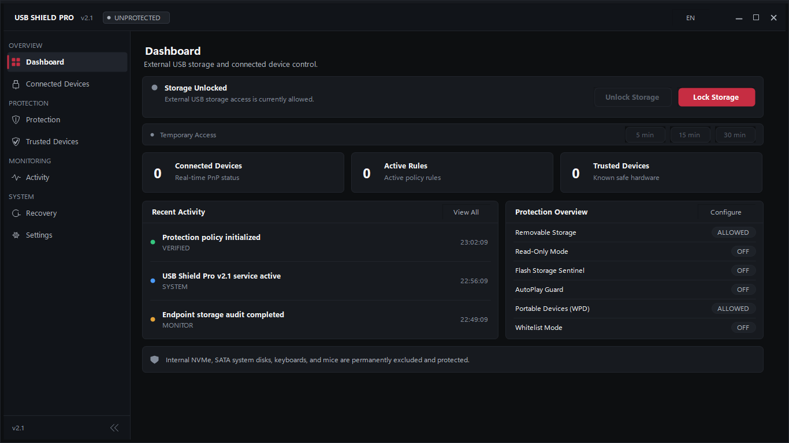
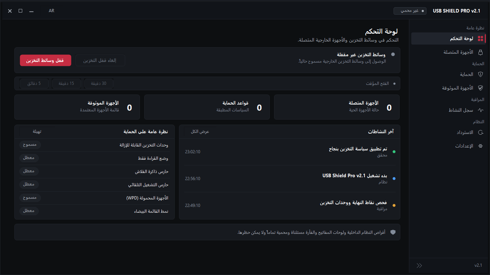
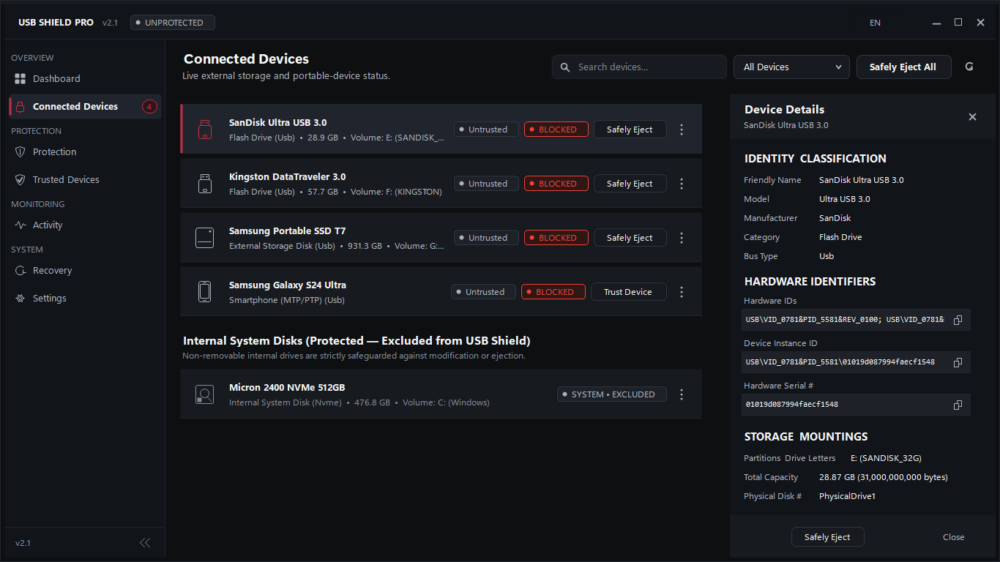
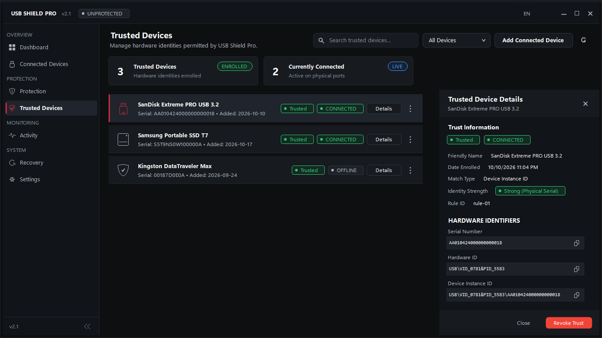
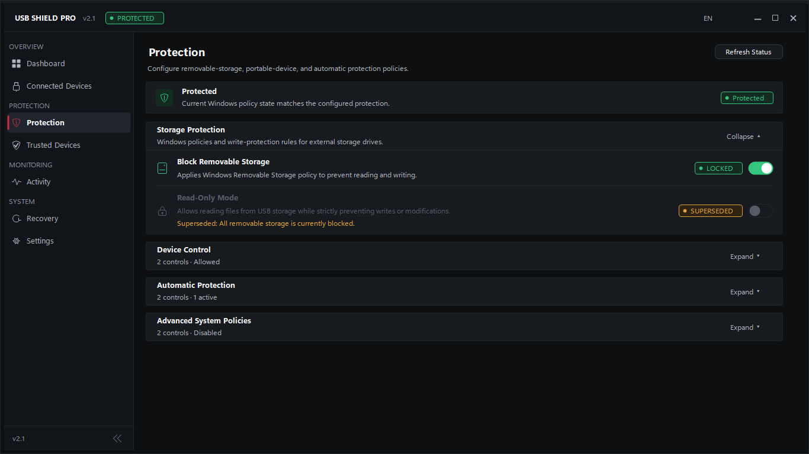
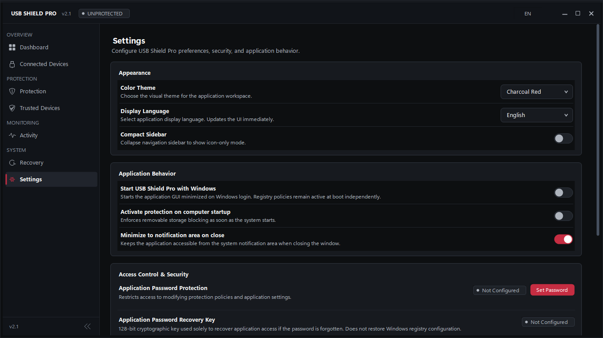
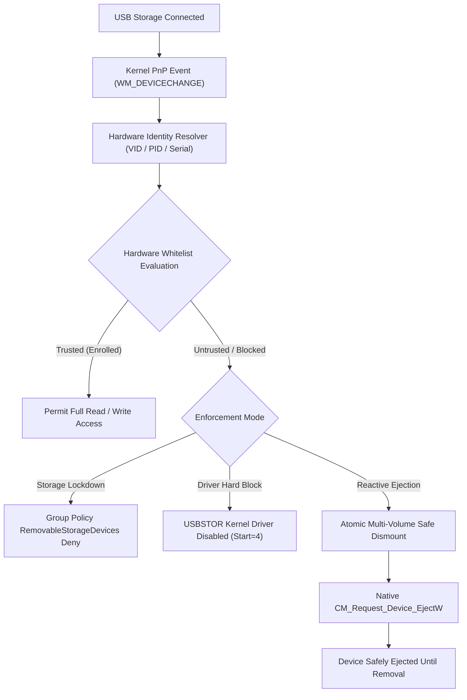

<p align="center">
  
</p>

<h1 align="center">USB Shield Pro</h1>

<p align="center">
  <strong>Enterprise-Grade Windows USB Endpoint Security, Hardware Allowlisting & Real-Time Storage Protection</strong>
</p>

<p align="center">
  <a href="README.md"><strong>English</strong></a> &bull;
  <a href="README.ar.md"><strong>العربية</strong></a>
</p>

<p align="center">
  <a href="https://github.com/0x-Abood/USB-Shield-Pro/releases/tag/v2.1.0"></a>
  <a href="https://github.com/0x-Abood/USB-Shield-Pro/actions/workflows/ci.yml"></a>
  
  
  
  
  <a href="LICENSE"></a>
</p>

---

## Overview

**USB Shield Pro** is an open-source endpoint security solution engineered to protect Windows 10 and 11 workstations from unauthorized USB storage peripherals, data exfiltration, and malicious hardware attacks (such as BadUSB and automated drive-by payloads).

Operating at the kernel driver boundary (`USBSTOR`) and native Plug-and-Play (PnP) subsystem, USB Shield Pro allows system administrators to enforce strict default-deny policies on removable storage while seamlessly permitting authenticated, cryptographically enrolled devices through hardware serial allowlisting.

---

## Key Features

- **Hardware Serial Allowlisting:** Grant access exclusively to approved flash drives and external disks by matching hardware serial numbers, vendor IDs, and product IDs (`VID/PID`).
- **Multi-Partition Safe Eject:** Engineered to reliably dismount and eject partitioned drives (e.g., Ventoy multi-boot drives, EFI system partitions, Windows To Go) without `PNP_VetoDevice` errors.
- **AV-Clean Architecture (Zero-Dropper):** Clean execution with zero script dropping (`.bat`, `.cmd`, `.ps1`). Service lifecycle operations run directly through native Win32 `advapi32.dll` APIs without spawning hidden subprocesses (`sc.exe` / `cmd.exe`).
- **Autonomous Windows Service:** 24/7 background enforcement daemon (`UsbShieldService`) that monitors hardware arrival events and applies security boundaries even before a user logs in.
- **Fail-Closed Safety Invariant:** Physical Disk 0, Windows boot drives, and active paging file volumes are hard-coded as protected system boundaries that can never be locked or ejected.
- **Disaster Recovery Baseline:** Atomic state recording captures the exact pre-Shield system configuration, enabling instant rollback via GUI or CLI (`--restore-defaults`).
- **Bilingual High-DPI Interface:** Native English (LTR) and Arabic (RTL) desktop UI with complete Right-to-Left layout mirroring and full PerMonitorV2 High-DPI support (100% to 200%).

---

## User Interface

<p align="center">
  
  
</p>
<p align="center">
  
  
</p>
<p align="center">
  
  
</p>

---

## Technical Architecture



---

## Core Security Capabilities

| Capability | Mechanism | Security Value |
| :--- | :--- | :--- |
| **Driver Hard Lock** | `USBSTOR\Start = 4` | Disables USB storage enumeration at the kernel driver layer. |
| **Removable Storage Deny** | `RemovableStorageDevices\Deny_All` | Enforces Windows Group Policy to block unauthorized read/write access. |
| **Write Protection Mode** | `StorageDevicePolicies\WriteProtect = 1` | Permits read-only inspection while blocking malware infection and data theft. |
| **Portable Device Guard (WPD)** | `WPD Devices\Deny_Read / Deny_Write` | Closes MTP/PTP file transfer channels used by smartphones and media players. |
| **PnP Installation Control** | `DeviceInstall\Restrictions\DenyRemovableDevices` | Prevents staging and installation of removable storage device drivers. |
| **AutoPlay Neutralization** | `NoDriveTypeAutoRun = 0xFF` | Disables AutoRun / AutoPlay execution across all removable media. |
| **Multi-Partition Safe Eject** | `FSCTL_LOCK` &rarr; `FSCTL_DISMOUNT` &rarr; `CM_Request_Device_EjectW` | Synchronously unmounts all dependent volumes, preventing data corruption. |
| **Autonomous System Service** | Native Win32 `advapi32.dll` | Proactive background monitoring independent of logged-in user sessions. |
| **Fail-Closed System Floor** | Disk 0 / OS Root / Paging Guard | Prevents accidental ejection of system disks and host OS boot partitions. |
| **Cryptographic Protection** | PBKDF2 (HMAC-SHA256) + DPAPI | Guards administrative access with master passwords and 128-bit recovery keys. |

---

## Downloads

| Package | Format | Size | Download Link | Integrity & Antivirus |
| :--- | :--- | :--- | :--- | :--- |
| **Native Installer** | `.exe` | `1,237,504 bytes` | [Download Setup.exe](https://github.com/0x-Abood/USB-Shield-Pro/releases/download/v2.1.0/USB-Shield-Pro-v2.1.0-Setup.exe) | [VirusTotal Clean (0/72)](https://www.virustotal.com/gui/file/a8e0db5305cd3099d0f0580b5eb5a97e54ce7352e108c199b6532cf85a203cdc) |
| **Portable Archive** | `.zip` | `383,102 bytes` | [Download Portable.zip](https://github.com/0x-Abood/USB-Shield-Pro/releases/download/v2.1.0/USB-Shield-Pro-v2.1.0-Portable.zip) | [VirusTotal Clean (0/72)](https://www.virustotal.com/gui/file/64c525ce05419592516eae76faa8a680df14d024d6b05bebcb4bf2300b0102ad) |
| **SHA-256 Manifest** | `.txt` | `2,811 bytes` | [Download Checksums](https://github.com/0x-Abood/USB-Shield-Pro/releases/download/v2.1.0/USB-Shield-Pro-v2.1-SHA256.txt) | Verified via `verify-release.ps1` |

---

## Command-Line Interface (CLI)

```cmd
:: Launch administrative desktop GUI (default)
UsbShieldPro.exe

:: Run hardware bus discovery diagnostic
UsbShieldPro.exe --diag-detect

:: Run as background Windows service daemon
UsbShieldPro.exe --service

:: Emergency rollback to pre-Shield baseline configuration
UsbShieldPro.exe --restore-defaults

:: Exact restoration from write-ahead state journal
UsbShieldPro.exe --restore-exact
```

---

## Official Release Checksums (SHA-256)

All production binaries are clean-room compiled (`/optimize+ /debug-`) without local machine paths, debug symbols, or dropper scripts.

| File Name | Target Type | Size (Bytes) | Official SHA-256 Checksum |
| :--- | :--- | :--- | :--- |
| **`USB-Shield-Pro-v2.1.0-Setup.exe`** | Native Installer | `1,237,504` | `A8E0DB5305CD3099D0F0580B5EB5A97E54CE7352E108C199B6532CF85A203CDC` |
| **`USB-Shield-Pro-v2.1.0-Portable.zip`** | Portable Archive | `383,102` | `64C525CE05419592516EAE76FAA8A680DF14D024D6B05BEBCB4BF2300B0102AD` |
| **`UsbShieldPro.exe`** | Standalone Executable | `1,060,864` | `4F9A904E9AB5236C18D298DD78443D5021DB5781BFCF16C0C037100DFEC5AFA9` |
| **`UsbShieldPro.exe.config`** | High-DPI Manifest | `598` | `53840DABDB7510AC21965024AEC4797025C920C965D29BBAA46FFA324338C5B1` |
| **`README.txt`** | Release Notes | `6,998` | `3B72B744C64DF260E54BBC5AE5B0888C9F742C320DB3C62C9D26D5CBC1DAEA4F` |

### Automated Verification Script (PowerShell):
Run the bundled verification script to verify downloaded binaries in one command:
```powershell
powershell -ExecutionPolicy Bypass -File .\verify-release.ps1 -FilePath ".\USB-Shield-Pro-v2.1.0-Setup.exe"
```

Or verify manually via native PowerShell:
```powershell
Get-FileHash -Path ".\USB-Shield-Pro-v2.1.0-Setup.exe" -Algorithm SHA256
```

---

## Building from Source

### System Requirements
- Windows 10 (v1903+) or Windows 11 (64-bit)
- Microsoft .NET Framework 4.8 Developer Pack or Runtime (`csc.exe` in `%SystemRoot%\Microsoft.NET\Framework64\v4.0.30319`)

### Build Steps
1. Clone the repository:
   ```cmd
   git clone https://github.com/0x-Abood/USB-Shield-Pro.git
   cd USB-Shield-Pro
   ```
2. Build the core executable and regression test harness:
   ```cmd
   build.bat
   ```
3. Build the self-contained native installer:
   ```cmd
   Installer\build_installer.bat
   ```
4. Run the regression test suite (27 Suites, 347 Assertions):
   ```cmd
   TestRunner.exe --test-harness
   ```

---

## License & Attribution

Distributed under the **MIT License**. See [`LICENSE`](LICENSE) for complete details.

Developed with &hearts; by **0xAbood**  
Official Repository: [https://github.com/0x-Abood/USB-Shield-Pro](https://github.com/0x-Abood/USB-Shield-Pro)
