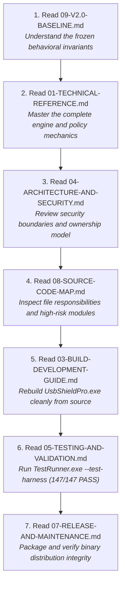

# USB Shield Pro v2.0 Documentation Archive

## Product Overview & Status

- **Product Name**: USB Shield Pro
- **Current Version**: 2.0 (Frozen Release Baseline)
- **Status**: **READY FOR DISTRIBUTION**
- **Copyright**: &copy; 2026 x0abood. All rights reserved.
- **Target Operating System**: Windows 10 / Windows 11 (64-bit / x64)
- **Runtime Environment**: Microsoft .NET Framework 4.8 (pre-installed on Windows 10 v1903+ and all Windows 11)
- **Primary Binary**: [`UsbShieldPro.exe`](../release/USB-Shield-Pro-v2.0/UsbShieldPro.exe) (Standalone executable, 812,544 bytes, `/platform:x64 /target:winexe /optimize+`)
- **Privilege Requirement**: Elevated Administrator privileges (`requireAdministrator` in embedded `app.manifest`)
- **Code Signing Status**: Unsigned (Legitimate state; no fake/self-signed certificates used)
- **Current Release Directory**: [`release\USB-Shield-Pro-v2.0\`](../release/USB-Shield-Pro-v2.0/)
- **Release Checksum Verification**: [`release\USB-Shield-Pro-v2.0-SHA256.txt`](../release/USB-Shield-Pro-v2.0-SHA256.txt)

---

## Architectural Summary

USB Shield Pro is a defense-in-depth USB endpoint protection and administrative device control suite for Windows. It provides physical USB storage port blocking, device whitelisting (trusted serials/hardware IDs), reactive PnP safe-ejection (`CM_Request_Device_EjectW`) with bounded retry, Windows AutoPlay suppression (AutoPlay Guard), and persistent audit logging.

The product uses a **hybrid dual-engine architecture**:
1. **Preventive Policy Layer**: Operates through Windows Group Policy and driver registry stacks (`RemovableStorageDevices`, `StorageDevicePolicies`, `DeviceInstall\Restrictions`, `AutoplayHandlers`, `Explorer\Policies`). Every registry mutation is guarded by an atomic write-ahead journal (`journal.json`) that captures the original baseline exactly once and generates standalone offline disaster recovery scripts (`USBShield_Restore.bat` and `USBShield_Restore.reg`).
2. **Reactive Enforcement Layer**: Intercepts device arrivals via Win32 PnP device notifications (`WM_DEVICECHANGE` / `RegisterDeviceNotificationW`). If an untrusted storage device arrives under reactive policies, the engine executes authoritative physical parent resolution, verifies safety (strictly excluding Disk 0 and internal buses), issues Microsoft-native `CM_Request_Device_EjectW`, monitors for `PNP_VetoDevice` on target volume/SCSI devnodes, schedules a single bounded retry targeting ~10s total device age, and commits a final terminal state (`EjectedUntilRemoval` or `FailedTerminal`) with zero legacy FSCTL dismount fallback.
3. **Execution Ownership Model**: Sole-owner architecture. When installed and running, the background Windows Service (`UsbShieldService`, Session 0) owns enforcement. When the service is absent or stopped, the interactive GUI (`MainForm`, Console Session 1) gracefully assumes fallback enforcement ownership. Both never enforce simultaneously.

---

## Documentation Map

This archive provides complete, engineering-grade documentation for developers, security auditors, system administrators, and future maintainers.

| Document | Filename | Purpose | When to Read It |
|---|---|---|---|
| **Documentation Index** | [`00-DOCUMENTATION-INDEX.md`](./00-DOCUMENTATION-INDEX.md) | Archive entry point, product status, and navigation guide. | First document to open when arriving at the repository. |
| **Technical Reference** | [`01-TECHNICAL-REFERENCE.md`](./01-TECHNICAL-REFERENCE.md) | Exhaustive technical specification of all components, backends, and behaviors. | Primary master document; read before designing changes or debugging. |
| **User Guide** | [`02-USER-GUIDE.md`](./02-USER-GUIDE.md) | End-user manual explaining operations, UI, AutoPlay Guard, and recovery. | When deploying to end-users or writing administrative runbooks. |
| **Build & Dev Guide** | [`03-BUILD-DEVELOPMENT-GUIDE.md`](./03-BUILD-DEVELOPMENT-GUIDE.md) | Clean compiler instructions, dependencies, test harness, and build scripts. | When setting up a build environment, compiling, or adding tests. |
| **Architecture & Security** | [`04-ARCHITECTURE-AND-SECURITY.md`](./04-ARCHITECTURE-AND-SECURITY.md) | Threat model, trust boundaries, privilege models, and Mermaid diagrams. | For architectural reviews, security audits, and threat assessments. |
| **Testing & Validation** | [`05-TESTING-AND-VALIDATION.md`](./05-TESTING-AND-VALIDATION.md) | Test harness suite (147 test cases), hardware validation history, and milestones. | When running regression tests or verifying enforcement mechanics. |
| **Recovery & Troubleshooting**| [`06-RECOVERY-AND-TROUBLESHOOTING.md`](./06-RECOVERY-AND-TROUBLESHOOTING.md) | Offline `.bat`/`.reg` rollback, `--restore-exact`, CLI repair, and triage. | During system rescue, configuration conflicts, or unexpected behavior. |
| **Release & Maintenance** | [`07-RELEASE-AND-MAINTENANCE.md`](./07-RELEASE-AND-MAINTENANCE.md) | Packaging procedure, versioning policy, integrity checks, and maintenance rules. | When preparing point releases, security patches, or binary distribution. |
| **Source Code Map** | [`08-SOURCE-CODE-MAP.md`](./08-SOURCE-CODE-MAP.md) | File-by-file audit of all 44 production C# source files, classes, and risks. | When locating specific logic, refactoring, or tracing data flow. |
| **v2.0 Baseline** | [`09-V2.0-BASELINE.md`](./09-V2.0-BASELINE.md) | Frozen invariant contract of the v2.0 release. | Mandatory pre-check before touching any production source code. |
| **Project Manifest** | [`PROJECT-MANIFEST.md`](./PROJECT-MANIFEST.md) | Compact machine-readable summary tables for AI agents and automated tools. | For quick reference of paths, constants, switches, and invariants. |

---

## If You Return to This Project After a Long Time

If months or years have passed since this codebase was touched, follow this exact reading order:

1. **[`09-V2.0-BASELINE.md`](./09-V2.0-BASELINE.md)**: Refresh your understanding of what is frozen: max 2 CM calls, ~10s retry target age, zero legacy FSCTL fallback, Disk 0 safety invariants, and exact baseline restore.
2. **[`01-TECHNICAL-REFERENCE.md`](./01-TECHNICAL-REFERENCE.md)**: Grasp the entire technical architecture, domain models, PnP ejection pipeline, and registry policy interactions.
3. **[`04-ARCHITECTURE-AND-SECURITY.md`](./04-ARCHITECTURE-AND-SECURITY.md)**: Study the threat model, Windows security boundaries, and single-enforcement-owner protocols.
4. **[`08-SOURCE-CODE-MAP.md`](./08-SOURCE-CODE-MAP.md)**: Locate the exact classes and files you need to inspect. Note the high-risk safety files.
5. **[`03-BUILD-DEVELOPMENT-GUIDE.md`](./03-BUILD-DEVELOPMENT-GUIDE.md)**: Execute a clean build using standard 64-bit .NET 4.8 `csc.exe` via `build.bat`.
6. **[`05-TESTING-AND-VALIDATION.md`](./05-TESTING-AND-VALIDATION.md)**: Run the full isolated test harness (`TestRunner.exe --test-harness`) and verify all 147 test cases pass with zero failures.
7. **[`07-RELEASE-AND-MAINTENANCE.md`](./07-RELEASE-AND-MAINTENANCE.md)**: Follow the release checklist before distributing any updated binary.

---

## Source of Truth Priority

When analyzing or modifying USB Shield Pro, conflicts between artifacts must be resolved according to this strict hierarchy:

1. **Current Production Source Code** (`Models\`, `Core\`, `Devices\`, `Persistence\`, `Security\`, `Windows\`, `Service\`, `UsbBlocker.cs`, `MainForm.cs`, etc.):
   The active, compiled C# source code represents the ultimate reality of system behavior.
2. **Current Test Harness** (`Core\TestHarness.cs`):
   The authoritative specification of expected behaviors, boundary conditions, and regression baselines.
3. **Build Scripts and Manifests** (`build.bat`, `app.manifest`):
   The authoritative definitions of compiler flags, target platform, optimization, and OS security elevation.
4. **This Documentation Archive** (`docs\*.md`):
   The definitive explanation of design rationale, operational guidelines, and architectural contracts.
5. **Historical Validation Logs and Scratch Artifacts** (`scratch\*`, legacy benchmark notes):
   Informational history only; never overrides current code or tests.
