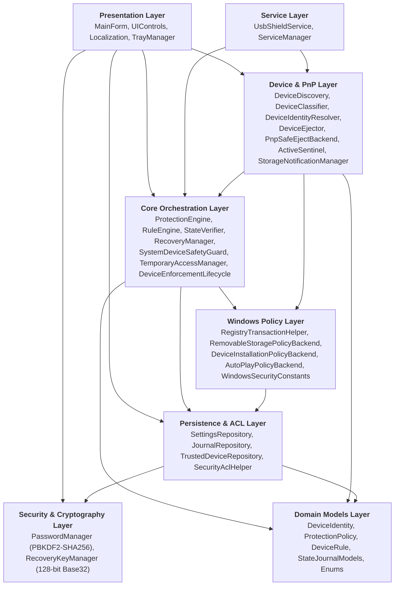
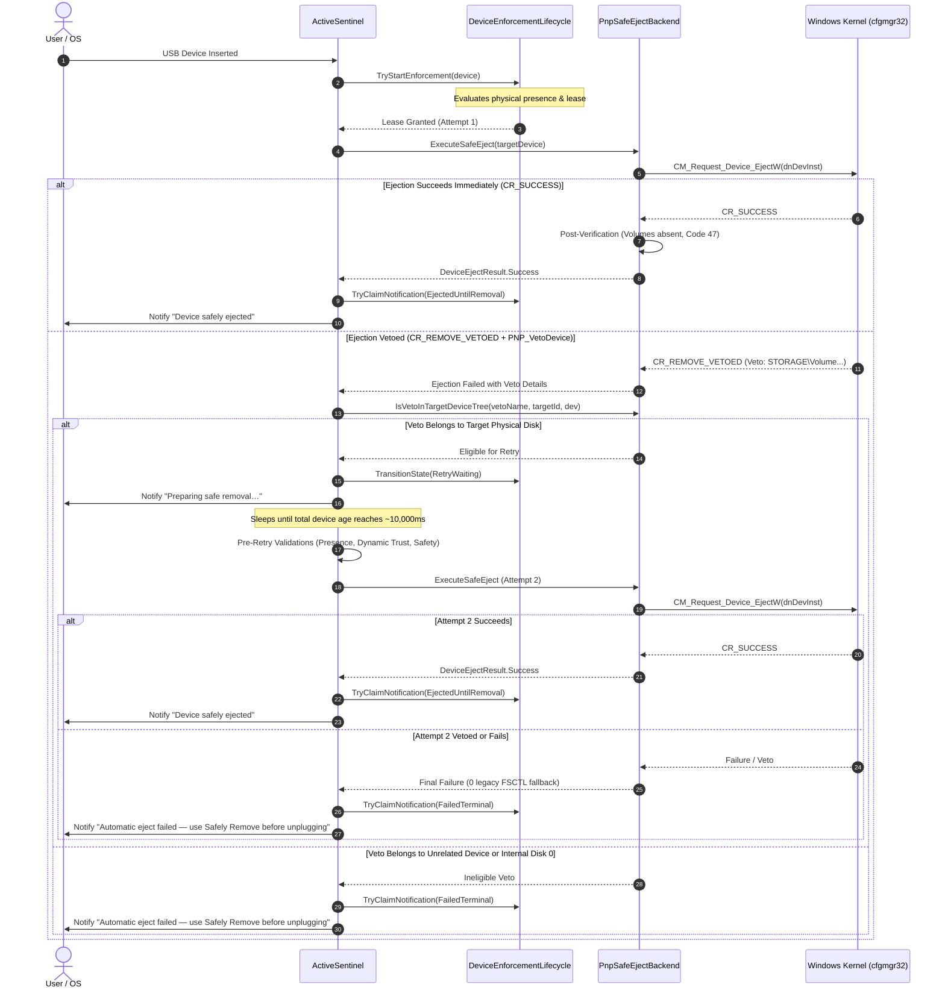
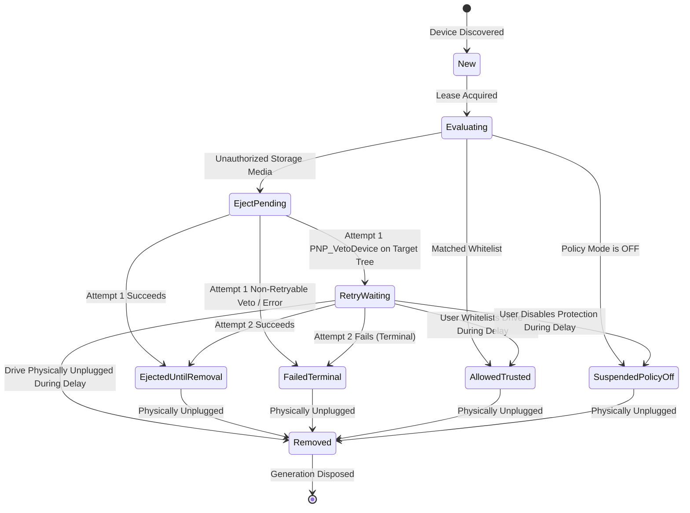
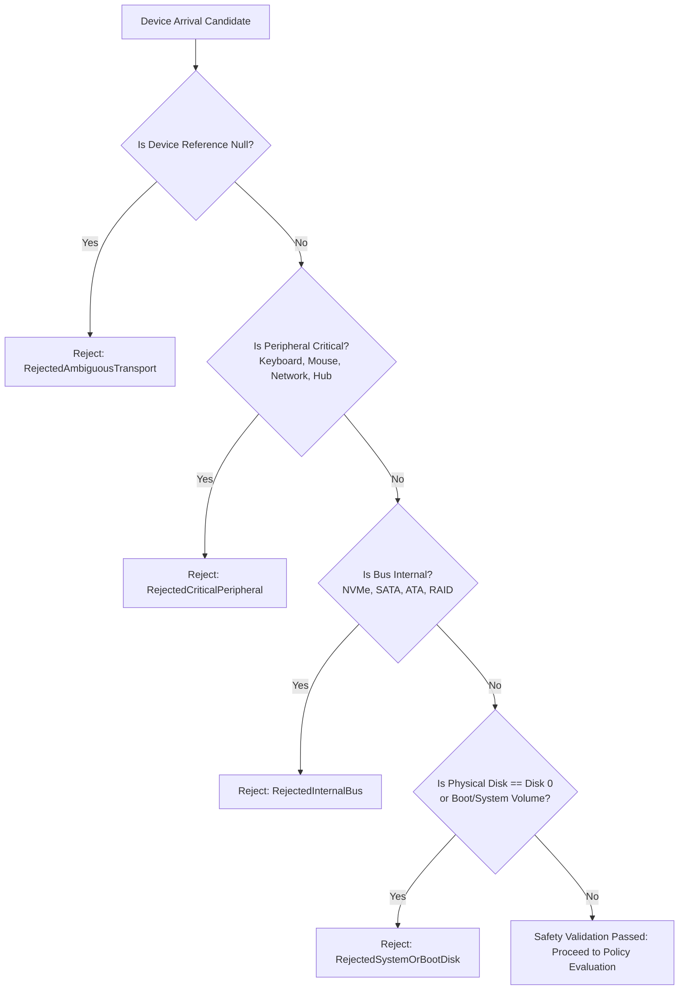

# USB Shield Pro v2.0 — Complete Technical Reference

**Document Classification**: Master Technical Specification  
**Product**: USB Shield Pro  
**Version**: 2.0 (Frozen Baseline)  
**Author**: x0abood  
**Target Platform**: Windows 10 / Windows 11 (64-bit / x64)  
**Runtime**: Microsoft .NET Framework 4.8  

---

## 1. Product Identity

- **Application Name**: USB Shield Pro
- **Current Version**: 2.0
- **Copyright**: &copy; 2026 x0abood. All rights reserved.
- **Binary Output**: [`UsbShieldPro.exe`](../release/USB-Shield-Pro-v2.0/UsbShieldPro.exe)
- **Target Architecture**: x64 (`/platform:x64 /target:winexe /optimize+`)
- **Required Framework**: .NET Framework 4.8 (built-in on Windows 10 version 1903 and higher, and all editions of Windows 11)
- **Execution Elevation**: Elevated Administrator (`requireAdministrator` declared in embedded `app.manifest`)
- **Authenticode Signing**: Unsigned (Legitimate state; no fake self-signed root certs generated)
- **Release Directory**: `release\USB-Shield-Pro-v2.0\`
- **Release Checksum File**: `release\USB-Shield-Pro-v2.0-SHA256.txt`

---

## 2. Product Purpose & Operational Boundaries

USB Shield Pro is an administrative endpoint security and device control application designed to restrict, monitor, and enforce access policies on USB storage media and Windows Portable Devices (WPD). 

### What USB Shield Pro Does:
1. **Physical Port Device Control**: Restricts the mounting and accessibility of external USB mass storage devices and portable media devices using official Windows Group Policy and driver stack configuration.
2. **Device Whitelisting**: Allows administrators to authorize specific trusted USB drives by unique physical serial number or PnP instance ID, while blocking all unauthorized hardware.
3. **Reactive Safe-Ejection**: For devices connected under flash-specific reactive policies, automatically requests immediate Plug and Play safe removal via Microsoft Configuration Manager (`CM_Request_Device_EjectW`) with a bounded, crash-safe retry.
4. **AutoPlay Suppression (AutoPlay Guard)**: Prevents Windows from automatically opening Explorer windows, launching handlers, or executing default media actions when external drives or smartphones are inserted.
5. **Read-Only Storage Enforcement**: Protects systems against data exfiltration by allowing users to read USB flash media while cryptographically and policy-denying write access.
6. **Zero-Lag Disaster Recovery**: Automatically captures pre-shield Windows configuration into an atomic write-ahead journal before any modification, maintaining standalone `.bat` and `.reg` rollback scripts that restore the exact initial baseline without requiring the application.

### What USB Shield Pro Does NOT Do:
> [!IMPORTANT]
> **USB SHIELD PRO IS NOT AN ANTIVIRUS OR ANTI-MALWARE SCANNER.**
> - It does not scan file payloads, inspect binary signatures, parse executable headers, or remove viruses, worms, or trojans.
> - It does not provide real-time filesystem heuristics or memory protection.
> - It does not protect against physical electrical attacks (e.g., USB Killer overvoltage devices).
> - It does not protect against BadUSB microcontroller hardware that impersonates Human Interface Devices (e.g., USB keyboards/mice), because input peripherals are intentionally excluded by `SystemDeviceSafetyGuard` to prevent system lockout.

---

## 3. Comprehensive Feature Matrix

| Feature | Technical Purpose | Implementation Layer | Persistent Across Reboots? | Requires Admin? | Preventive or Reactive? | Recovery Supported? | Architectural Limitations |
|---|---|---|---|---|---|---|---|
| **Global Storage Lockdown** | Blocks all removable storage drives globally | `RemovableStoragePolicyBackend` (`Deny_All`) | Yes (Registry GPO) | Yes | Preventive | Yes (`.bat`/`.reg`/CLI) | Affects all removable storage classes equally. |
| **Removable Disks Policy** | Restricts standard USB mass storage class drives | `RemovableStoragePolicyBackend` (`GuidRemovableDisks`) | Yes (Registry GPO) | Yes | Preventive | Yes (`.bat`/`.reg`/CLI) | Windows storage policy cannot differentiate flash drives from external SSDs. |
| **WPD / Phone Restrictions** | Blocks Windows Portable Devices (smartphones, MTP/PTP) | `RemovableStoragePolicyBackend` (`GuidWindowsPortableDevices`) | Yes (Registry GPO) | Yes | Preventive | Yes (`.bat`/`.reg`/CLI) | Does not block pure charging-only USB connections. |
| **Read-Only Mode** | Prevents write access while allowing read operations | `RemovableStoragePolicyBackend` & `StorageDevicePolicies` | Yes (Registry GPO) | Yes | Preventive | Yes (`.bat`/`.reg`/CLI) | Storage write cache flushing may require remount to take full effect. |
| **AutoPlay Guard** | Suppresses automatic media launching and handlers | `AutoPlayPolicyBackend` (`DisableAutoplay` & `NoAutoplayfornonVolume`) | Yes (Registry GPO & HKCU) | Yes | Preventive | Yes (`.bat`/`.reg`/CLI) | Does not replace antimalware; preserves existing `NoDriveTypeAutoRun`. |
| **Reactive Safe-Eject** | Safely removes untrusted storage drives upon arrival | `PnpSafeEjectBackend` (`CM_Request_Device_EjectW`) | Runtime session only | Yes | Reactive | N/A (Device removal) | Best-effort: Windows kernel or file handles can veto safe ejection. |
| **Bounded Eject Retry** | Targets ~10s age for `PNP_VetoDevice` on target tree | `ActiveSentinel` & `DeviceEnforcementLifecycleManager` | Runtime session only | Yes | Reactive | N/A (Transient state) | Maximum 2 CM calls; exactly 0 legacy FSCTL dismount fallback. |
| **Device Whitelist** | Authorizes trusted USB drives by serial / PnP ID | `TrustedDeviceRepository` (`trusted_devices.json`) | Yes (NTFS Protected JSON) | Yes | Preventive & Reactive | Yes (JSON Backup & Purge) | Strongest security requires unique physical hardware serials. |
| **Temporary Access** | Provides timed unlock window with auto-relock | `TemporaryAccessManager` (`temp_access.json`) | Yes (Disk state persists reboot) | Yes | Preventive Override | Yes (Automatic re-lock on expiry) | If system reboots during window without service, flags `PendingRelock`. |
| **System Safety Guard** | Prevents accidental targeting of Disk 0 / boot media | `SystemDeviceSafetyGuard` | Hardcoded in core | No | Preventive (Safety Guard) | N/A (Guaranteed invariant) | Internal buses and boot disks are unconditionally excluded. |
| **Background Service** | Headless Session 0 monitoring and enforcement | `UsbShieldService` & `ServiceManager` | Yes (Windows Service) | Yes | Continuous Background | Yes (Service uninstaller) | GUI yields enforcement ownership when service is running. |
| **Bilingual GUI** | Complete Arabic and English native interface | `Localization`, `MainForm`, `UIControls` | Yes (Per-user settings) | Yes | Presentation | N/A | RTL mirroring applied programmatically on form controls. |

---

## 4. Layered Architecture Overview

The software is organized into 8 modular layers with strict dependency boundaries:

---

## 5. Core Components Deep-Dive

### 5.1 [`ProtectionEngine`](../Core/ProtectionEngine.cs)
- **Role**: Coordinates high-level protection policy application, synchronization between UI toggles and Windows policy backends, and verification.
- **Key Methods**:
  - `ApplyPolicy(ProtectionPolicy desiredPolicy, out List<string> errors)`: Applies requested rules (BlockRemovableDisks, ReadOnlyRemovable, AutoPlayGuard, HardBlockUsbStor) through corresponding Windows backends.
  - `QueryCurrentProtectionStatus()`: Evaluates active system state and returns a `ProtectionStatusReport`.
  - `ReconcileProtectionState()`: Re-applies desired policy if an external drift is detected.

### 5.2 [`RuleEngine`](../Core/RuleEngine.cs)
- **Role**: Evaluates individual `DeviceIdentity` objects against active `ProtectionPolicy` and `TrustedDeviceRepository` rules.
- **Key Methods**:
  - `EvaluateDevice(DeviceIdentity dev, ProtectionPolicy policy)`: Returns `RuleAction` (`AllowTrusted`, `DenyBlocked`, `ReadOnly`) and sets `ActivationState`.
  - Enforces safety invariants by passing every device through `SystemDeviceSafetyGuard.ValidateDevice` prior to rule matching.

### 5.3 [`StateVerifier`](../Core/StateVerifier.cs)
- **Role**: Reads live registry values directly from 64-bit registry views to confirm that configured policies are physically present in the kernel.
- **Key Methods**:
  - `VerifyActivePolicies(ProtectionPolicy expectedPolicy, out List<string> discrepancies)`: Audits registry values against memory policy.
  - Returns `ActivationState.AppliedAndVerified` only when 100% of keys match expected values.

### 5.4 [`RecoveryManager`](../Core/RecoveryManager.cs)
- **Role**: Generates and executes disaster recovery packages.
- **Key Invariant**: **NEVER "Restore Windows Defaults" — ALWAYS restore the exact pre-shield baseline.**
- **Key Methods**:
  - `GenerateRecoveryPackage(string customExportDirectory = null)`: Writes pre-computed rollback files `USBShield_Restore.bat` and `USBShield_Restore.reg` to `%ProgramData%\USBShieldPro\`.
  - `RestorePreShieldState(out List<string> errors)`: Programmatic rollback engine reading directly from `journal.json`.

### 5.5 [`TemporaryAccessManager`](../Core/TemporaryAccessManager.cs)
- **Role**: Manages timed temporary policy suspensions.
- **Key Methods**:
  - `GrantTemporaryAccess(int durationMinutes, out string error)`: Temporarily suspends storage blocking, records expiration in `temp_access.json`, and starts timer.
  - `CheckAndEnforceExpiration()`: Called periodically and on application startup; if UTC clock exceeds expiration time, immediately re-applies original protection policy and updates disk state.

### 5.6 [`SystemDeviceSafetyGuard`](../Core/SystemDeviceSafetyGuard.cs)
- **Role**: Absolute security boundary protecting internal disks, operating system volumes, and critical input peripherals.
- **Key Invariant**: **Fail-Open on any ambiguity (Never target if uncertain). Disk 0 is permanently protected.**
- **Key Methods**:
  - `ValidateDevice(DeviceIdentity device, out string reason)`: Returns `SafetyValidationResult` (`Passed`, `RejectedSystemOrBootDisk`, `RejectedInternalBus`, `RejectedCriticalPeripheral`, `RejectedAmbiguousTransport`).
  - `GetSystemPhysicalDiskNumber()`: Dynamically queries IOCTL `IOCTL_STORAGE_GET_DEVICE_NUMBER` on the Windows system directory drive (typically `C:`) to determine the host boot disk number.

### 5.7 [`ActiveSentinel`](../Devices/ActiveSentinel.cs)
- **Role**: Real-time event consumer and reactive enforcement orchestrator.
- **Key Methods**:
  - `Start()` / `Stop()`: Registers PnP device arrival listener via `StorageNotificationManager`.
  - `OnDeviceArrival(DeviceIdentity dev)`: Dispatches arrival through lifecycle manager, executes bounded safe-eject retry, dispatches pending UX events, and logs audit traces.

### 5.8 [`DeviceEnforcementLifecycleManager`](../Core/DeviceEnforcementLifecycle.cs)
- **Role**: Manages the multi-generation, per-physical-device lifecycle state machine.
- **Key Methods**:
  - `BuildPhysicalKey(DeviceIdentity dev)`: Computes authoritative composite key `VID_xxxx&PID_xxxx#SERIAL#DISK_n`.
  - `TryStartEnforcement(...)`, `TransitionState(...)`, `TryClaimNotification(...)`: Thread-safe, lock-bounded state machine transitions.

---

## 6. Device Layer Specification

### 6.1 Device Discovery & Classification
- **Enumeration**: [`DeviceDiscovery`](../Devices/DeviceDiscovery.cs) queries Win32 SetupAPI device enumerators (`USB`, `USBSTOR`, `UASPSTOR`, `WPD`, `STORAGE\Volume`) and Windows Management Instrumentation (WMI / `Win32_DiskDrive`).
- **Physical Disk Identification**: Resolves physical drive index via `IOCTL_STORAGE_GET_DEVICE_NUMBER` (`\\.\PhysicalDriveN`).
- **Ancestry Walk**: [`PnpHelper.GetPhysicalUsbAncestorInstanceId`](../Core/DeviceEnforcementLifecycle.cs#L106) executes a bounded tree traversal up to 10 levels deep using `CM_Get_Parent` to locate the true physical USB root (`USB\VID_xxxx&PID_xxxx\...`).
- **Classification**: [`DeviceClassifier`](../Devices/DeviceClassifier.cs) categorizes hardware into `UsbFlashDrive`, `ExternalUsbSsd`, `ExternalUsbHdd`, `MobilePhoneOrMediaDevice`, or `InternalFixedDisk`.

### 6.2 Volume-to-Disk Correlation
Because Windows volume devnodes (`STORAGE\Volume...`) are parented under `ROOT\volmgr\0000` rather than the physical USB tree, PnP safe-eject vetoes referencing volume devnodes cannot be matched by simple parent-child tree queries.
[`PnpSafeEjectBackend.IsVetoInTargetDeviceTree`](../Devices/PnpSafeEjectBackend.cs#L587) handles this via authoritative storage mapping:
1. Detects `STORAGE\Volume` prefix.
2. Queries volume extents via `IOCTL_VOLUME_GET_VOLUME_DISK_EXTENTS`.
3. Resolves underlying `PhysicalDiskNumber`.
4. Enforces:
   - Must match the target device's `PhysicalDiskNumber`.
   - Must NOT be internal Disk 0.
   - If IOCTL fails, correlates via Windows device `ContainerID`.

---

## 7. Windows Policy Backends & Registry Schema

All registry mutations route strictly through [`RegistryTransactionHelper`](../Windows/RegistryTransactionHelper.cs), which writes to `journal.json` and regenerates offline recovery scripts before mutating Windows state.

| Feature / Policy | Hive | Registry Path | Value Name | Type | Value When ON | Value When OFF | Baseline Capture Policy |
|---|---|---|---|---|---|---|---|
| **Global Storage Block** | HKLM | `SOFTWARE\Policies\Microsoft\Windows\RemovableStorageDevices` | `Deny_All` | `REG_DWORD` | `1` | Deleted | Captured once in journal |
| **Removable Disks Deny Write** | HKLM | `SOFTWARE\Policies\Microsoft\Windows\RemovableStorageDevices\{53f5630d-b6bf-11d0-94f2-00a0c91efb8b}` | `Deny_Write` | `REG_DWORD` | `1` | Deleted | Captured once in journal |
| **Removable Disks Deny Read** | HKLM | `SOFTWARE\Policies\Microsoft\Windows\RemovableStorageDevices\{53f5630d-b6bf-11d0-94f2-00a0c91efb8b}` | `Deny_Read` | `REG_DWORD` | `1` | Deleted | Captured once in journal |
| **Storage WriteProtect** | HKLM | `SYSTEM\CurrentControlSet\Control\StorageDevicePolicies` | `WriteProtect` | `REG_DWORD` | `1` | Deleted | Captured once in journal |
| **WPD Deny Write** | HKLM | `SOFTWARE\Policies\Microsoft\Windows\RemovableStorageDevices\{6AC27878-A6FA-4155-BA85-F98F491D4F33}` | `Deny_Write` | `REG_DWORD` | `1` | Deleted | Captured once in journal |
| **WPD Deny Read** | HKLM | `SOFTWARE\Policies\Microsoft\Windows\RemovableStorageDevices\{6AC27878-A6FA-4155-BA85-F98F491D4F33}` | `Deny_Read` | `REG_DWORD` | `1` | Deleted | Captured once in journal |
| **Layered Device Install** | HKLM | `SOFTWARE\Policies\Microsoft\Windows\DeviceInstall\Restrictions` | `AllowDenyLayered` | `REG_DWORD` | `1` | Deleted | Captured once in journal |
| **Strict Device Install Deny** | HKLM | `SOFTWARE\Policies\Microsoft\Windows\DeviceInstall\Restrictions` | `DenyRemovableDevices` | `REG_DWORD` | `1` | Deleted | Captured once in journal |
| **Allowed Instance IDs** | HKLM | `SOFTWARE\Policies\Microsoft\Windows\DeviceInstall\Restrictions\AllowInstanceIDs` | Sequenced (`1`, `2`...) | `REG_SZ` | Instance ID | Deleted | Individual indexed rollback |
| **AutoPlay Master Switch** | HKCU | `Software\Microsoft\Windows\CurrentVersion\Explorer\AutoplayHandlers` | `DisableAutoplay` | `REG_DWORD` | `1` | Restored to baseline | Restores exact pre-shield state (deleted if absent, restored to value if existed) |
| **AutoPlay Non-Volume** | HKLM | `SOFTWARE\Policies\Microsoft\Windows\Explorer` | `NoAutoplayfornonVolume` | `REG_DWORD` | `1` | Restored to baseline | Restores exact pre-shield state |
| **NoDriveTypeAutoRun** | HKLM | `Software\Microsoft\Windows\CurrentVersion\Policies\Explorer` | `NoDriveTypeAutoRun` | `REG_DWORD` | *Unmodified* | *Unmodified* | **PRESERVED**: Read-only inspected; never overwritten |
| **USBSTOR Driver Service** | HKLM | `SYSTEM\CurrentControlSet\Services\USBSTOR` | `Start` | `REG_DWORD` | `3` (Standard) / `4` (HardBlock) | `3` | Captured in baseline |
| **UASPSTOR Driver Service** | HKLM | `SYSTEM\CurrentControlSet\Services\uaspstor` | `Start` | `REG_DWORD` | `3` (Standard) / `4` (HardBlock) | `3` | Captured in baseline |

---

## 8. AutoPlay Guard Architecture

AutoPlay Guard disables Windows AutoPlay handlers for newly connected media and portable devices while strictly preserving administrative AutoRun policies.

### Implementation Details:
1. **Target Values**:
   - `HKCU\Software\Microsoft\Windows\CurrentVersion\Explorer\AutoplayHandlers\DisableAutoplay = 1`
   - `HKLM\SOFTWARE\Policies\Microsoft\Windows\Explorer\NoAutoplayfornonVolume = 1`
2. **Exact Baseline Preservation**:
   - If `DisableAutoplay` was absent prior to activation, toggling OFF deletes the value.
   - If `DisableAutoplay` was already set to `0` or `1`, toggling OFF restores that exact value.
3. **NoDriveTypeAutoRun Invariant**:
   - Windows distinguishes between **AutoPlay** (Explorer content sniffing / handler prompts) and **AutoRun** (`autorun.inf` execution). AutoPlay Guard does not touch `NoDriveTypeAutoRun`. Existing enterprise GPOs remain intact.
4. **No Explorer Restart**:
   - Windows Explorer monitors these registry keys dynamically; no destructive `taskkill /f /im explorer.exe` or system reboot is required.

---

## 9. Auto-Eject Architecture & Bounded Retry

### Key Auto-Eject Invariants:
1. **Microsoft-Native API**: Calls `CM_Request_Device_EjectW` directly from `cfgmgr32.dll`.
2. **Zero Legacy Fallback**: If PnP ejection is vetoed or fails, the engine **strictly NEVER** calls legacy FSCTL dismounts (`FSCTL_LOCK_VOLUME`, `FSCTL_DISMOUNT_VOLUME`, `IOCTL_STORAGE_EJECT_MEDIA`). Legacy fallback risks corrupting filesystem structures on held handles.
3. **Bounded Retry Parameters**:
   - Maximum CM calls per cycle: **2**.
   - Eligibility: Attempt 1 ONLY, returning `CR_REMOVE_VETOED` with veto type `PNP_VetoDevice` on a devnode belonging to the target device tree.
   - Target age: Schedules retry delay so execution occurs at approximately **10,000 ms (10 seconds)** of total device connection age.
4. **Code 47 Verification**: `CM_PROB_HELD_FOR_EJECT` (Problem 47) is accepted as successful post-verification. The physical parent devnode is held disabled pending physical unplug.

---

## 10. Enforcement Lifecycle State Machine

### State Definitions:
- **`New`**: Initial arrival observed; unleased.
- **`Evaluating`**: Worker lease acquired; safety and whitelist verification in progress.
- **`EjectPending`**: Issuing CM eject request to Windows kernel.
- **`RetryWaiting`**: Attempt 1 vetoed by target tree devnode; sleeping until ~10s total age. Emits `Preparing safe removal…`.
- **`EjectedUntilRemoval`**: Terminal success; device safely ejected; volumes unmounted; parent in Code 47. Emits `Device safely ejected`.
- **`FailedTerminal`**: Terminal failure; max retries exceeded or non-retryable veto. Emits `Automatic eject failed — use Safely Remove before unplugging`.
- **`AllowedTrusted`**: Terminal pass; device matches whitelist; active until physically removed.
- **`SuspendedPolicyOff`**: Policy disabled; device left unhindered.
- **`Removed`**: Device physically absent; cancels pending retries; frees lease.

---

## 11. Trusted Devices & Whitelisting

The whitelist engine in [`TrustedDeviceRepository`](../Persistence/TrustedDeviceRepository.cs) persists rules to `%ProgramData%\USBShieldPro\trusted_devices.json`.

### Identity Confidence Hierarchy:
1. **Strong (`RuleMatchType.SerialNumber`)**: Device provides a valid, unique physical serial number in its PnP path. Highest trust fidelity.
2. **Medium (`RuleMatchType.DeviceInstanceId`)**: Matches exact PnP instance ID on the specific port connection.
3. **Weak (`RuleMatchType.HardwareId`)**: Matches VID/PID/REV. Not recommended for strict environments because malicious devices can clone vendor IDs.

---

## 12. Storage Protection Modes

Windows policy mechanisms impose fundamental constraints on storage classification:
- **Windows Removable Storage Policy (`RemovableStorageDevices`)**: Does **not** distinguish between USB flash thumb drives and USB external hard drives/SSDs. Both present the Removable Disks class GUID (`{53f5630d-b6bf-11d0-94f2-00a0c91efb8b}`) if marked removable by device descriptor.
- **Reactive Flash-Specific Mode**: Employs `ActiveSentinel` to dynamically inspect drive geometry, SCSI inquiry data, and bus properties. If the device is classified as a flash thumb drive, reactive PnP safe-eject is applied while leaving external fixed hard drives unaffected.

---

## 13. WPD / MTP Behavior

Windows Portable Devices (smartphones, cameras, media players) operate under setup class `{eec5ad98-8080-425f-922a-dab33962f594}`.
- **Storage Volume Proxies**: Windows frequently instantiates a WPD proxy node (`SWD\WPDBUSENUM\...`) for standard USB mass storage volumes. [`DeviceClassifier.DetermineWpdKind`](../Devices/DeviceClassifier.cs#L22) detects and suppresses these proxies to prevent duplicate notifications.
- **Genuine MTP**: Smartphones communicating over pure Media Transfer Protocol (MTP) are handled via WPD policy toggles (`GuidWindowsPortableDevices`) and are never sent to PnP disk ejection.

---

## 14. Safety Model & Invariants

USB Shield Pro enforces strict non-negotiable safety rules:

1. **Physical Disk 0 Hard Invariant**: The Windows boot and system disk (`\\.\PhysicalDrive0`) is hard-coded as non-ejectable.
2. **No Destructive Disk Operations**: Zero formatting, zero partition resizing, zero chkdsk invocations, zero partition table modifications.
3. **No Process Murder**: Explorer.exe and host processes are never killed to force handle releases.
4. **Fail-Open on Uncertainty**: If bus transport or disk geometry is ambiguous, ejection is aborted.

---

## 15. Service vs GUI Ownership Model

Enforcement ownership is mutually exclusive and managed by [`EnforcementOwnerResolver`](../Core/EnforcementOwnerResolver.cs):
- **When Service Is Running**: `UsbShieldService` (Session 0) holds sole enforcement ownership. The GUI runs as an administrative viewer/configuration console and disables its internal Sentinel worker.
- **When Service Is Absent/Stopped**: The GUI Sentinel automatically activates fallback enforcement ownership.
- **Transition Protocol**: When starting the service from the GUI, `PrepareForServiceStart()` suspends the GUI worker and waits for in-flight requests to settle before starting the service. When stopping the service, a 300 ms settling delay is enforced before GUI fallback activates.

---

## 16. Persistence & File Security

All persistent state is stored in `%ProgramData%\USBShieldPro\` with strict NTFS ACLs:
- **Owner**: `BUILTIN\Administrators`
- **Inheritance**: Stripped / Disabled
- **Access Rules**:
  - `NT AUTHORITY\SYSTEM`: FullControl
  - `BUILTIN\Administrators`: FullControl
  - Standard users: No Read, No Write, No Traverse

### State Files:
- `journal.json`: Atomic write-ahead transaction log and pre-shield baseline.
- `settings.json`: Application settings (language, startup preferences, UI scale).
- `trusted_devices.json`: Whitelisted devices list.
- `temp_access.json`: Active temporary access session.
- `.auth`: DPAPI-encrypted PBKDF2 password hash.
- `.recovery`: DPAPI-encrypted PBKDF2 Master Recovery Key hash.

---

## 17. Recovery Architecture

The recovery system guarantees that any system can be returned to its exact pre-shield configuration without running the application binary:
1. **Pre-Computed Offline Scripts**: Generated on every policy mutation into `%ProgramData%\USBShieldPro\`:
   - `USBShield_Restore.bat`: Command-line rollback using standard Windows `reg.exe`.
   - `USBShield_Restore.reg`: Standard Windows Registry editor registration file.
2. **CLI Exact Rollback**: Executing `UsbShieldPro.exe --restore-exact` reads the pre-shield baseline from `journal.json` and restores original values.
3. **Absence Integrity**: If a key/value did not exist before USB Shield Pro touched it, recovery explicitly deletes the value rather than assigning default data.

---

## 18. Password & Master Recovery Key

- **Password Hashing**: PBKDF2-HMAC-SHA256 with **100,000 iterations** and a 32-byte cryptographically random salt.
- **Protection**: Hash stored in `.auth`, encrypted using Windows DPAPI (`DataProtectionScope.LocalMachine`).
- **Timing Protection**: Verification uses `ConstantTimeEquals` to prevent timing side-channel attacks.
- **Master Recovery Key**: 128-bit cryptographic entropy encoded into Crockford Base32 (`SHLD-XXXXX-XXXXX-XXXXX-XXXXX-XXXXX-X`). Stored in `.recovery` with DPAPI. Used exclusively to reset a forgotten administrative password.

---

## 19. Temporary Access Lifecycle

Managed by [`TemporaryAccessManager`](../Core/TemporaryAccessManager.cs):
1. User requests temporary unlock (e.g., 15, 30, 60 minutes).
2. Current policy is preserved in `temp_access.json`.
3. Blocking policies are removed.
4. An active countdown timer tracks expiration.
5. Upon expiration (or upon startup if expired while offline), original policies are automatically re-applied.

---

## 20. UI Architecture & Bilingual Localization

- **Framework**: Windows Forms, high-DPI aware, GDI+ double-buffered custom rendering (`UIControls.cs`).
- **TopMost Policy**: `TopMost = false` across all forms and dialogs to avoid intrusive focus stealing.
- **Bilingual Engine**: [`Localization.cs`](../Localization.cs) supports English and Arabic (`Language.English`, `Language.Arabic`). Arabic mode automatically applies Right-to-Left (`RightToLeft.Yes`) mirroring and bidirectional glyph layout.
- **Standardized UX Copy**:
  - *Pending Retry*: "Preparing safe removal…" / "جارٍ التحضير للإزالة الآمنة…"
  - *Terminal Success*: "Device safely ejected" / "تم إخراج الجهاز بأمان"
  - *Terminal Failure*: "Automatic eject failed — use Safely Remove before unplugging" / "فشل الإخراج التلقائي — استخدم «الإزالة الآمنة» قبل فصل الجهاز"

---

## 21. Command-Line Interface (CLI)

| Switch | Purpose | Privilege Requirement | Production Safe? |
|---|---|---|---|
| *(No args)* | Launches the interactive bilingual GUI | Administrator | Yes |
| `--service` | Runs executable as background Windows Service host | SYSTEM / LocalService | Yes |
| `--diag-detect` | Non-destructive CLI device detection & safety inspection | Administrator | Yes |
| `--diag-security` | Audits NTFS ACLs and ownership on `%ProgramData%` | Administrator | Yes |
| `--restore-exact` | Programmatic rollback to exact pre-shield baseline | Administrator | Yes |
| `--install-service` | Registers `UsbShieldService` with Windows SCM | Administrator | Yes |
| `--uninstall-service`| Removes `UsbShieldService` from Windows SCM | Administrator | Yes |
| `--test-harness` | Runs isolated in-memory unit/regression test harness | Administrator | Developer / CI only |
| `--capture-pass3` | Generates 12 QA release screenshots in temp directory | Administrator | Developer / QA only |
| `--force` / `--no-mutex`| Bypasses single-instance global mutex check | Administrator | Developer / Diagnostics |

---

## 22. Runtime Files and Directories

| Path | Created By | Purpose | Persistent? | Sensitive Data? | Safe to Delete? |
|---|---|---|---|---|---|
| `C:\ProgramData\USBShieldPro\` | `SecurityAclHelper` | Main configuration repository | Yes | Yes (Protected ACL) | No (Contains baseline) |
| `...\journal.json` | `JournalRepository` | Write-ahead baseline and transaction log | Yes | No | No (Breaks rollback) |
| `...\settings.json` | `SettingsRepository` | User UI preferences & settings | Yes | No | Yes (Reverts to defaults)|
| `...\trusted_devices.json` | `TrustedDeviceRepository` | Whitelisted trusted USB devices | Yes | No | Yes (Clears whitelist) |
| `...\temp_access.json` | `TemporaryAccessManager` | Active temporary unlock state | Yes | No | Yes (Cancels unlock) |
| `...\.auth` | `PasswordManager` | DPAPI-encrypted password hash | Yes | Yes | Yes (Clears password) |
| `...\.recovery` | `RecoveryKeyManager` | DPAPI-encrypted recovery key hash | Yes | Yes | Yes (Clears recovery key)|
| `...\USBShield_Restore.bat` | `RecoveryManager` | Standalone emergency rollback script | Yes | No | Yes (Regenerated on write)|
| `...\USBShield_Restore.reg` | `RecoveryManager` | Standalone emergency rollback registry file | Yes | No | Yes (Regenerated on write)|
| `%TEMP%\UsbShieldPro_startup.log`| `Program` | Early startup execution checkpoint log | No | No | Yes (Ephemeral trace) |

---

## 23. Threading, Timers, and Concurrency

- **PnP Window Hook**: `StorageNotificationManager` allocates a hidden message window handle (`HWND`) on an STA UI thread or dedicated message pump to receive `WM_DEVICECHANGE` broadcasts.
- **Worker Execution**: Enforcement requests run on background threadpool tasks. A generation and cycle ID check ensures that stale tasks never commit state transitions.
- **Retry Timer**: `ActiveSentinel` delays using `Task.Delay` with cancellation token support. If the user whitelists the device or physically unplugs it during the 10-second wait, the timer is aborted immediately.

---

## 24. Known Limitations & Edge Cases

1. **Best-Effort PnP Safe-Eject**: Windows Plug and Play safe removal is inherently cooperative. If a third-party process (antivirus, backup agent, disk indexing service) maintains an unyielding open handle to a partition volume, Windows kernel will veto both eject attempts.
2. **Delayed Eject UX**: Bounded retry targeting ~10s total age means that devices encountering `PNP_VetoDevice` will intentionally remain connected for up to 10 seconds while waiting for Windows background volume mounting to stabilize.
3. **No Antivirus Capability**: USB Shield Pro cannot inspect files for malware or malicious scripts.
4. **Unsigned Executable**: Windows SmartScreen will display an unknown publisher notification upon first run until an enterprise Authenticode certificate is applied.
5. **Elevation Requirement**: Due to PnP tree manipulation and local machine registry policies, the application cannot run under standard non-administrative user accounts.

---

## 25. Core Architectural Rationale ("Why")

- **Why maximum 2 CM eject calls?** Attempt 1 addresses immediate safe-eject. If Windows is actively mounting filesystems (`PNP_VetoDevice`), Attempt 2 provides a clean window after handles settle. Issuing more than 2 calls produces disruptive PnP bus thrashing.
- **Why retry targeting ~10s age?** Production hardware telemetry proved that Windows volume cataloging and metadata indexing for newly inserted FAT32/NTFS USB media typically completes within 6 to 9 seconds of arrival.
- **Why ZERO FSCTL fallback?** Forcing volume dismount via `FSCTL_DISMOUNT_VOLUME` after Windows has explicitly vetoed PnP removal bypasses operating system safety controls and can lead to unwritten dirty cache loss.
- **Why exact baseline restoration?** Different organizations configure custom Windows policies. Restoring hardcoded "default" settings could wipe out legitimate corporate configurations.
- **Why permanent Disk 0 protection?** Physical Disk 0 contains the host boot partitions. Ejecting or dismounting Disk 0 causes an immediate Windows Blue Screen of Death (BSOD).
- **Why single enforcement owner?** Running dual enforcement engines in both the Windows Service and the interactive GUI leads to race conditions, duplicate PnP eject requests, and inconsistent UI state.
