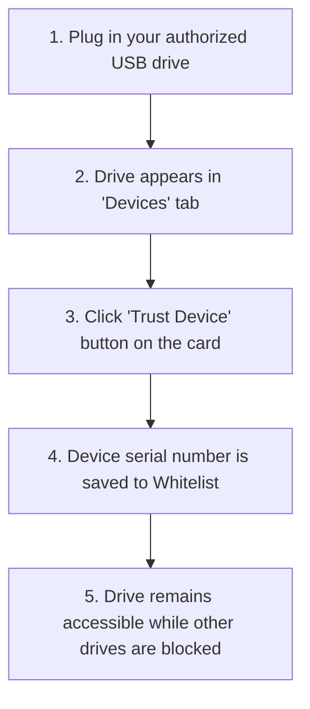

# USB Shield Pro v2.0 — User Guide

Welcome to **USB Shield Pro v2.0**. This guide walks you through setting up, configuring, and using USB Shield Pro to protect your Windows computer against unauthorized USB storage drives and automated malware execution.

---

## 1. Getting Started

### System Requirements
- **Operating System**: Windows 10 or Windows 11 (64-bit / x64 editions).
- **Software Framework**: Microsoft .NET Framework 4.8 (already pre-installed on Windows 10 version 1903+ and all Windows 11 systems).
- **Permissions**: Administrator rights are required to manage USB device policies and Plug and Play hardware.

### Running the Application
1. Navigate to the folder containing `UsbShieldPro.exe`.
2. Double-click **`UsbShieldPro.exe`**.
3. If prompted by Windows User Account Control (UAC), click **Yes** to allow administrative access.
4. On your first launch, the application will initialize its secure configuration folder in `C:\ProgramData\USBShieldPro\` and display the main dashboard.

---

## 2. Main Interface Walkthrough

USB Shield Pro features a clean, high-DPI bilingual interface organized into four primary tabs:

```
┌────────────────────────────────────────────────────────────────────────┐
│  [🛡️ USB Shield Pro v2.0]                     [AR / EN]  [_] [X]        │
├────────────────────────────────────────────────────────────────────────┤
│  [ 📱 Devices ]  [ 🔒 Protection Rules ]  [ 📜 Activity ]  [ ⚙️ Settings ] │
├────────────────────────────────────────────────────────────────────────┤
│                                                                        │
│   Active Hardware View / Policy Configuration / Event Audit Log        │
│                                                                        │
├────────────────────────────────────────────────────────────────────────┤
│  Status: Protected | Engine: Active | Single Owner: GUI Mode           │
└────────────────────────────────────────────────────────────────────────┘
```

1. **Devices Tab**: Displays all currently connected USB controllers, flash drives, portable hard disks, and smartphones. Shows drive letters, physical serial numbers, connection status, and quick-trust actions.
2. **Protection Rules Tab**: Central control panel for all security policies, including global storage lockdown, read-only mode, AutoPlay Guard, and whitelisting.
3. **Activity Tab**: Real-time chronological audit trail of all device arrivals, safe-ejection attempts, PnP vetoes, policy changes, and security events.
4. **Settings Tab**: Administrative password protection, Master Recovery Key management, language selection (English / Arabic), and Windows background service options.

---

## 3. Protection Features Explained

### 3.1 Block Removable Disks
- **What it does**: Restricts access to standard USB flash drives and external hard drives. Unauthorized drives will display an "Access Denied" prompt when opened in Windows Explorer.
- **When to use**: When you want to prevent unauthorized portable media from accessing the computer.

### 3.2 Read-Only Removable Media
- **What it does**: Allows users to open and read files from USB drives, but strictly blocks writing, modifying, creating, or deleting files.
- **When to use**: When employees or students need to copy files *from* a flash drive onto the computer without risking data leakage or malware being written back to the drive.

### 3.3 AutoPlay Guard
- **What it does**: Disables Windows AutoPlay for newly connected drives, memory cards, and smartphones. Windows will no longer automatically pop open folder windows, run default programs, or prompt for actions when a device is plugged in.
- **When to use**: Recommended to keep **ON** at all times to avoid accidental clicks on untrusted media prompts.

### 3.4 Windows Portable Devices (Phones & Media Players)
- **What it does**: Restricts smartphones and portable cameras connected over MTP/PTP protocol.
- **When to use**: To prevent smartphones from being mounted as storage drives while allowing them to charge safely.

### 3.5 Auto-Eject (Reactive Protection)
- **What it does**: If an unauthorized USB drive is inserted while protection is active, USB Shield Pro immediately issues a safe-ejection request to Windows. If Windows needs a few seconds to finish mounting volumes, the application will display "Preparing safe removal…" and retry once before finalizing.

---

## 4. Trusted Devices (Whitelisting)

Whitelisting allows you to designate authorized USB drives that are always permitted to connect, even when general USB access is blocked.



### How to Trust a Device:
1. Connect your USB drive to the computer.
2. Open USB Shield Pro and navigate to the **Devices** tab.
3. Locate the card corresponding to your drive (identified by model, drive letter, and size).
4. Click **Trust Device**.
5. The device card will turn green with a **Trusted** badge. The drive's unique hardware serial number is now recorded in the whitelist.

### How to Remove Trust:
1. Navigate to **Protection Rules** &rarr; **Trusted Devices** (or locate the drive in the **Devices** tab).
2. Click **Revoke Trust** or **Delete**.
3. The drive will immediately be treated as untrusted.

---

## 5. Understanding Auto-Eject Notifications

When an untrusted drive is inserted, you may see one of the following notifications in your Windows system tray:

| Notification | Meaning | What You Should Do |
|---|---|---|
| **"Preparing safe removal…"** | The drive was detected and an initial safe-eject request was issued. Windows reported that background file systems or services are still cataloging the disk. A single retry is scheduled to run in a few seconds. | **Do NOT unplug the drive yet.** Wait a few seconds for the retry to finish. |
| **"Device safely ejected"** | Windows has successfully and safely unmounted all volumes. The drive's activity LED will typically turn off or go idle. | You may now safely unplug the physical drive. |
| **"Automatic eject failed — use Safely Remove before unplugging"** | Windows background programs (such as file indexing, open Explorer windows, or antivirus scans) refused to release their handles to the drive after retries. | **Do NOT yank the drive out.** Click the standard Windows "Safely Remove Hardware" icon in your taskbar tray before physically unplugging. |

---

## 6. Temporary Access (Timed Unlock)

If you need to connect an untrusted USB drive for a brief period (e.g., copying a presentation or inspecting a file):

1. Go to the **Protection Rules** tab.
2. Under **Temporary Access**, select the desired duration (e.g., **15 minutes**, **30 minutes**, or **1 hour**).
3. Click **Grant Temporary Access**.
4. A countdown timer will appear at the top of the window. All USB restrictions are temporarily lifted.
5. When the countdown timer reaches zero, USB Shield Pro automatically re-engages your full protection policy without requiring any action.

---

## 7. Password Protection & Master Recovery Key

To prevent unauthorized users or students from disabling USB protection:

### Setting an Administrative Password:
1. Navigate to the **Settings** tab.
2. Under **Administrative Security**, click **Set Password**.
3. Enter a strong password and confirm it.
4. Once set, access to changing protection rules, trusting devices, or exiting the application will require this password.

### Master Recovery Key:
When setting a password, the system generates a **128-bit Master Recovery Key** formatted like:
`SHLD-XXXXX-XXXXX-XXXXX-XXXXX-XXXXX-X`

> [!IMPORTANT]
> **Write down your Master Recovery Key and store it in a secure location.**  
> If you forget your password, clicking **Forgot Password?** on the login screen will prompt you for this key to reset your administrative credentials.

---

## 8. Emergency Recovery & System Rollback

USB Shield Pro records your original Windows configuration before applying any changes. If the application is ever uninstalled incorrectly or you need to restore your computer to its exact pre-shield state:

### Emergency Offline Rollback Procedure:
1. Open Windows File Explorer and navigate to:  
   `C:\ProgramData\USBShieldPro\`
2. Locate the file **`USBShield_Restore.bat`**.
3. Right-click **`USBShield_Restore.bat`** and select **Run as administrator**.
4. A command prompt window will open, restore all original Windows registry settings, and confirm completion.
5. Alternatively, you can double-click **`USBShield_Restore.reg`** and click **Yes** to merge original registry values.

---

## 9. Language Selection (English / العربية)

USB Shield Pro is fully bilingual:
- Click the **Language** toggle in the top-right corner of the window (labeled **AR** or **EN**).
- When Arabic is selected, the application completely mirrors its layout (Right-to-Left) and translates all messages, status badges, and notifications into clear Arabic.

---

## 10. Frequently Asked Questions & Scenarios

### "I want only trusted company USB drives to work."
- **Action**: Turn ON **Block Removable Disks** and turn ON **Whitelist Mode**. Plug in each authorized company drive and click **Trust Device**. Any unauthorized drive plugged in by an employee or visitor will be blocked or ejected.

### "I want to allow users to read files from USB, but prevent them from copying files out of the PC."
- **Action**: Turn ON **Read-Only Removable Media**. Users will be able to open documents, view PDFs, and run presentations directly from their USB drives, but any attempt to save files to the USB drive will be blocked by Windows.

### "Auto-Eject failed for my USB drive. Is my computer safe?"
- **Action**: Yes. Even if automatic safe-ejection fails because Windows held an open handle, standard access permissions or read-only policies remain enforced. Use the Windows "Safely Remove Hardware" icon in the taskbar notification area to release the drive before unplugging.

---

## 11. Troubleshooting Common Symptoms

| Symptom | Probable Cause | Recommended Action |
|---|---|---|
| **Drive still appears in Explorer after insertion** | Drive is whitelisted, or Windows delayed volume unmounting during retry. | Check the **Devices** tab to confirm trust state. If untrusted, check the **Activity** tab to see if a safe-eject retry is currently in progress. |
| **"Access is Denied" when launching app** | Application was started without Administrator elevation. | Right-click `UsbShieldPro.exe` and select **Run as administrator**. |
| **Forgot application password** | Password was lost or forgotten. | Click **Forgot Password?** on the unlock prompt and enter your 128-bit Master Recovery Key (`SHLD-...`). |
| **System settings not returning to normal after closing app** | Protection policies are designed to remain active in Windows even when the GUI is closed. | To disable policies, toggle rules to OFF inside the app, or run `C:\ProgramData\USBShieldPro\USBShield_Restore.bat`. |

---

## 12. Important Safety Warnings

> [!CAUTION]
> **Data Loss Prevention**: Never violently yank an active USB drive out of the computer while file transfers are underway. If an automatic safe-ejection notification reports failure, always use Windows "Safely Remove Hardware" to prevent filesystem corruption.

> [!WARNING]
> **Not an Antivirus**: USB Shield Pro controls device access and disables AutoPlay. It does **not** scan files for computer viruses. Always use a dedicated antivirus scanner (such as Microsoft Defender) alongside USB Shield Pro.
