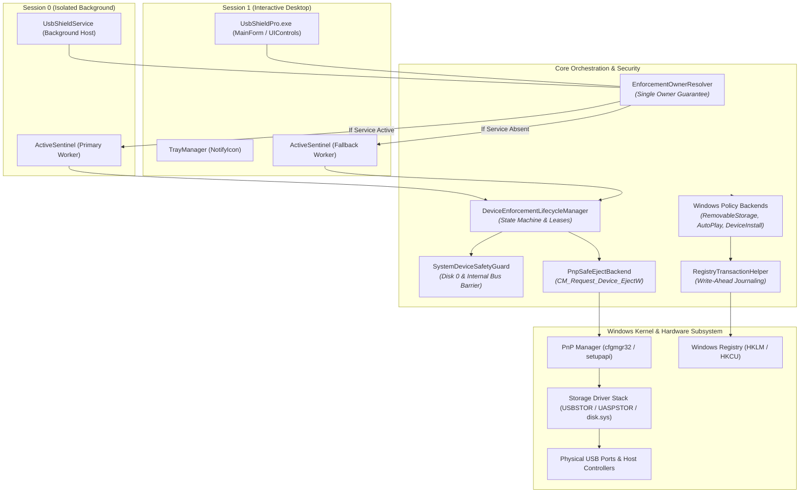
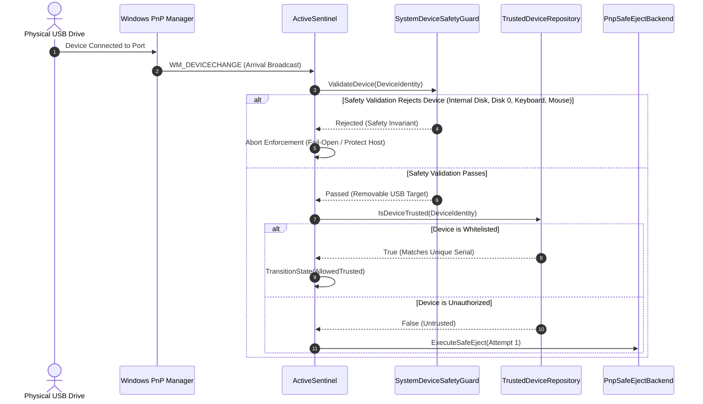
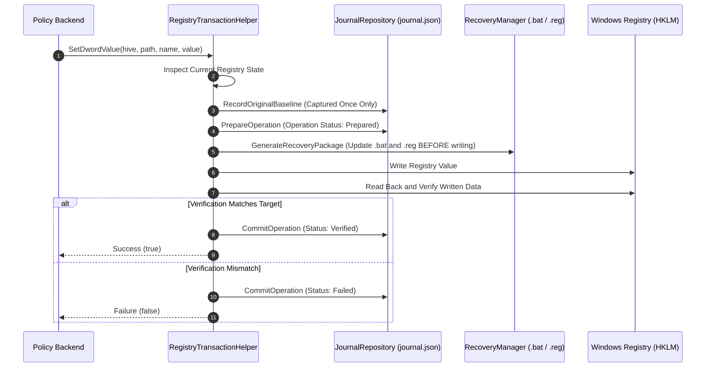
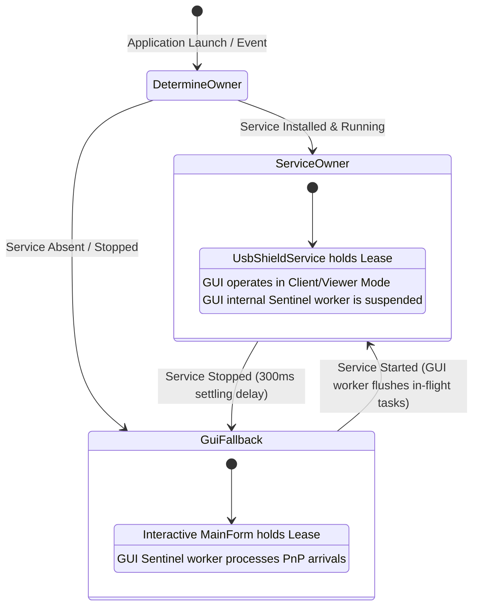

# USB Shield Pro v2.0 — Architecture & Security Specification

This document details the security architecture, threat model, trust boundaries, privilege separation, and defensive invariants of USB Shield Pro v2.0.

---

## 1. High-Level System Architecture

USB Shield Pro combines kernel-level Windows policy enforcement with real-time Plug and Play (PnP) event processing and single-owner service arbitration:



---

## 2. Threat Model & Security Boundaries

### 2.1 Attacker Assumptions & In-Scope Threats
1. **Unsanctioned Removable Storage**: Users connecting unapproved USB thumb drives, external hard disks, or flash cards to extract confidential data or introduce unauthorized executables.
   - *Defense*: Global storage lockdown, Read-Only policies, and reactive PnP safe-ejection.
2. **Automated Media Launching (AutoPlay / AutoRun)**: Exploitation of Windows shell handlers, automatic media prompting, or shortcut execution upon media insertion.
   - *Defense*: AutoPlay Guard suppresses `DisableAutoplay` and `NoAutoplayfornonVolume` while preserving administrative `NoDriveTypeAutoRun`.
3. **Smartphone / MTP Data Exfiltration**: Connection of modern smartphones that bypass standard mass storage restrictions by mounting over MTP/PTP.
   - *Defense*: WPD class policies (`GuidWindowsPortableDevices`).
4. **Local Standard User Tampering**: Non-administrative users attempting to modify configuration files, delete the transaction journal, or wipe the trusted whitelist.
   - *Defense*: Restrictive NTFS ACLs and ownership enforcement on `%ProgramData%\USBShieldPro\`.
5. **Accidental Boot Drive Destruction**: Software errors targeting internal operating system disks during mass storage blocking or ejection.
   - *Defense*: Non-negotiable `SystemDeviceSafetyGuard` barrier.

### 2.2 Out-of-Scope Threats (Honest Limitations)
> [!WARNING]
> **Defensive Boundaries**: USB Shield Pro does NOT claim to mitigate the following attack vectors:
> - **Malicious File Payloads**: If a drive is whitelisted or temporary access is active, USB Shield Pro does not inspect file contents for malware.
> - **BadUSB / HID Emulation**: Microcontrollers (e.g., Rubber Ducky) that identify as keyboards or mice are strictly excluded from storage blocking to prevent system lockout.
> - **Compromised Local Administrator**: A malicious actor with full local Administrator privileges can stop processes, alter registry keys directly, or bypass userland hooks.
> - **Hardware Electrical Destruction**: Overvoltage/USB-Killer devices destroy hardware at the electrical layer before any software or driver initializes.

---

## 3. Enforcement Lifecycle & Arrival Workflow

The following diagram illustrates how an arriving device traverses the safety barrier, whitelist check, and PnP ejection pipeline:



---

## 4. Auto-Eject Bounded Retry Architecture

Windows safe removal is inherently cooperative. When an unauthorized device arrives, background Windows services (such as indexing, volume cataloging, or file system driver initialization) frequently hold transient handles, generating `CR_REMOVE_VETOED` with veto type `PNP_VetoDevice`.

To prevent premature failure while avoiding infinite loops or PnP bus hammering, USB Shield Pro enforces a **bounded retry model**:

```mermaid
flowchart TD
    Start[Device Arrival: Attempt 1] --> IssueCM1[Call CM_Request_Device_EjectW]
    IssueCM1 --> CheckRes1{Result?}
    
    CheckRes1 -- CR_SUCCESS --> Verify[Post-Verification: Code 47 & Disappeared Volumes]
    Verify --> TermSuccess[Terminal State: EjectedUntilRemoval<br/><i>Emit 'Device safely ejected'</i>]
    
    CheckRes1 -- CR_REMOVE_VETOED --> CheckVeto{Is Veto Type == PNP_VetoDevice<br/>AND Veto in Target Tree?}
    CheckRes1 -- Other Error --> TermFail[Terminal State: FailedTerminal<br/><i>Emit 'Automatic eject failed'</i>]
    
    CheckVeto -- No (Unrelated Veto / Non-VetoDevice) --> TermFail
    CheckVeto -- Yes (Target Tree Veto) --> Wait[Transition to RetryWaiting<br/>Emit 'Preparing safe removal…'<br/>Sleep until total age reaches ~10,000ms]
    
    Wait --> PreChecks{Pre-Retry Checks:<br/>1. Still physically present?<br/>2. Not whitelisted during delay?<br/>3. Protection still ON?<br/>4. Target still valid?<br/>5. Safety still passes?}
    
    PreChecks -- Any Check Fails --> AbortRetry[Abort Retry cleanly / Update State]
    PreChecks -- All Checks Pass --> IssueCM2[Call CM_Request_Device_EjectW (Attempt 2)]
    
    IssueCM2 --> CheckRes2{Result?}
    CheckRes2 -- CR_SUCCESS --> Verify
    CheckRes2 -- Any Failure / Veto --> TermFail

    style TermSuccess fill:#d4edda,stroke:#28a745,color:#155724
    style TermFail fill:#f8d7da,stroke:#721c24,color:#721c24
```

### Invariants:
1. **Max Calls**: Exactly 2 `CM_Request_Device_EjectW` calls maximum per insertion cycle.
2. **Zero FSCTL Fallback**: Strictly 0 legacy `FSCTL_DISMOUNT_VOLUME` or `FSCTL_LOCK_VOLUME` calls.
3. **Volume Correlation**: Vetoes referencing `STORAGE\Volume` devnodes parented under `ROOT\volmgr\0000` correlate to the physical device's disk number and are rejected if they resolve to Disk 0.

---

## 5. Registry Transaction & Disaster Recovery Architecture

To ensure Windows is never left in an unrecoverable or corrupted state, all policy changes follow an atomic write-ahead journal protocol:



---

## 6. Service vs GUI Ownership Model

Enforcement ownership is mutually exclusive to eliminate race conditions between Session 0 and Session 1:



---

## 7. Cryptographic & Credential Security

1. **Password Authentication Engine**:
   - **Algorithm**: PBKDF2-HMAC-SHA256 (`Rfc2898DeriveBytes`).
   - **Iteration Count**: **100,000 rounds**.
   - **Salt**: 32 bytes from `RNGCryptoServiceProvider`.
   - **Storage**: Hash string format `V2$PBKDF2-SHA256$100000$SALT$HASH` encrypted with Windows Data Protection API (DPAPI) using `DataProtectionScope.LocalMachine` into `%ProgramData%\USBShieldPro\.auth`.
   - **Verification**: Evaluated with `ConstantTimeEquals` to eliminate timing side-channel leakage. Sensitive plaintext buffers are zeroed via `Array.Clear`.

2. **Master Recovery Key Engine**:
   - **Entropy**: 128 bits (16 bytes) of cryptographic randomness.
   - **Encoding**: Crockford Base32 (`0123456789ABCDEFGHJKMNPQRSTVWXYZ`) avoiding ambiguous characters (I, L, O, U).
   - **Formatting**: `SHLD-XXXXX-XXXXX-XXXXX-XXXXX-XXXXX-X`.
   - **Storage Invariant**: Plaintext key is displayed to the administrator ONCE upon generation and **NEVER written to disk**. Only the PBKDF2-SHA256 hash (100k iterations) is saved to `%ProgramData%\USBShieldPro\.recovery` under DPAPI encryption.
